# Práctica 2 SGE – Odoo 19 Community nativo en Ubuntu Server 24.04

**Enunciado:** Instala PostgreSQL 16 y Odoo 19 Community en Ubuntu Server 24.04. Administra el servidor desde Windows mediante SSH y configura Nginx para acceder a Odoo mediante HTTPS. Utiliza los apartados 4, 5 y 6 del tema como referencia.

> Guía de trabajo. Los bloques **"Para el informe"** son texto ya redactado para pegar en la plantilla.
> Los bloques de comandos son para ejecutar. Donde pone 📸 hay que hacer captura.
> Sustituye `TU_USUARIO`, `TU_NOMBRE` y `NOMBRE_VM` por tus valores.

---

## 0. Preparación en Windows (antes de empezar)

### Qué necesitas tener en local

| Qué | Dónde se consigue |
|---|---|
| ISO de **Ubuntu Server 24.04** (`ubuntu-24.04.x-live-server-amd64.iso`, ~3 GB) | https://releases.ubuntu.com/24.04/ |
| **VirtualBox** | https://www.virtualbox.org/wiki/Downloads |
| Cliente **SSH** | Viene en Windows 10/11 (`ssh -V` en PowerShell) |
| Plantilla Nginx **`odoo_ua2`** y **plantilla del informe** | Plataforma del curso (la tarea) |

PostgreSQL, Odoo y Nginx **no** se descargan en Windows: se instalan dentro de Ubuntu con `apt` (apartados 2 y 6).

### Descarga automática

Desde PowerShell, en la carpeta del repositorio:

```bash
powershell -ExecutionPolicy Bypass -File .\descargar_requisitos.ps1
```

El script descarga la última ISO de Ubuntu Server 24.04 en la carpeta `descargas\` del repositorio (excluida de git en `.gitignore`), comprueba su huella SHA256 (que no esté corrupta), descarga e instala VirtualBox con `winget` (el instalador también queda en `descargas`) y revisa el cliente SSH y la virtualización.

📸 Salida del script: ISO 24.04.5 verificada, VirtualBox 7.2.22, cliente SSH y virtualización por hardware correctos.

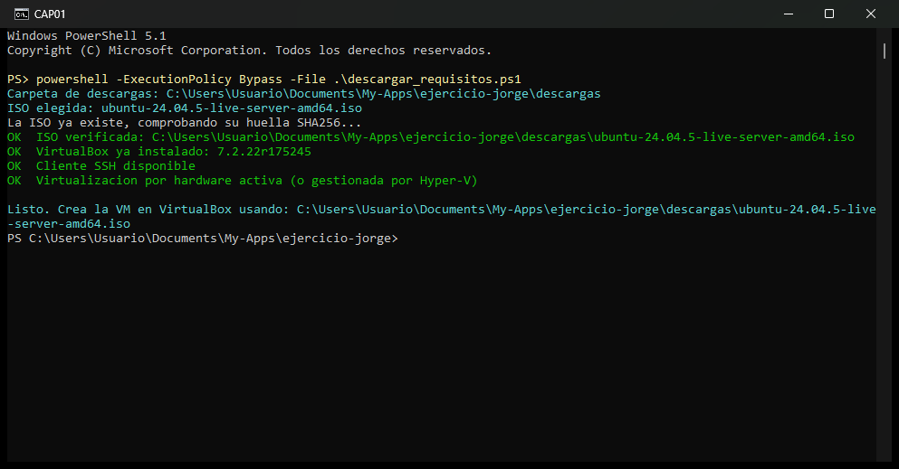

### Crear la máquina virtual

- Nombre: `Ubuntu Server 24.04` · Tipo: Linux / **Ubuntu 24.04 LTS (64-bit)**.
- RAM: 4096 MB · CPU: 2 · Disco: 25 GB (dinámico) · Firmware: BIOS.
- Red: Adaptador 1 en **NAT**.
- Instalación: se usó la **instalación desatendida** de VirtualBox (usuario `vboxuser`, equipo `Ubuntu-Server`). Si prefieres instalar a mano, marca "Omitir instalación desatendida" y en el instalador elige teclado **Spanish**, disco entero, tu usuario y **"Install OpenSSH server"**.
- Diferencias de la instalación desatendida: el teclado queda en inglés (US) y **no instala OpenSSH**; se instaló después con `sudo apt install openssh-server` (apartado 1).
- El asistente dejó 1 CPU y el tipo "Ubuntu 24.10"; se corrigieron con la VM apagada:

```bash
"C:\Program Files\Oracle\VirtualBox\VBoxManage.exe" modifyvm "Ubuntu Server 24.04" --cpus 2 --os-type Ubuntu24_LTS_64
```

📸 Configuración de la VM (nombre, tipo, RAM, CPU, virtualización, red NAT y disco de 25 GB dinámico):

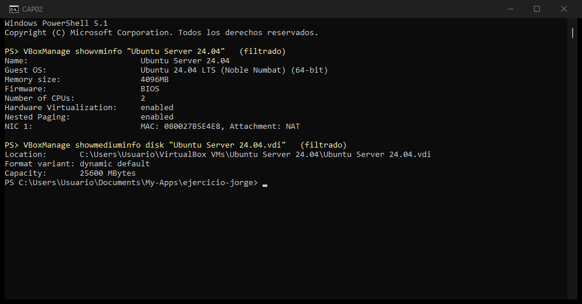

📸 Ubuntu instalado y arrancado: usuario `vboxuser`, Ubuntu 24.04.5 LTS, kernel 6.8, 2 CPU, 3,8 GiB de RAM, disco de 25 GB, red `enp0s3` con IP de NAT `10.0.2.15` y SSH activo:

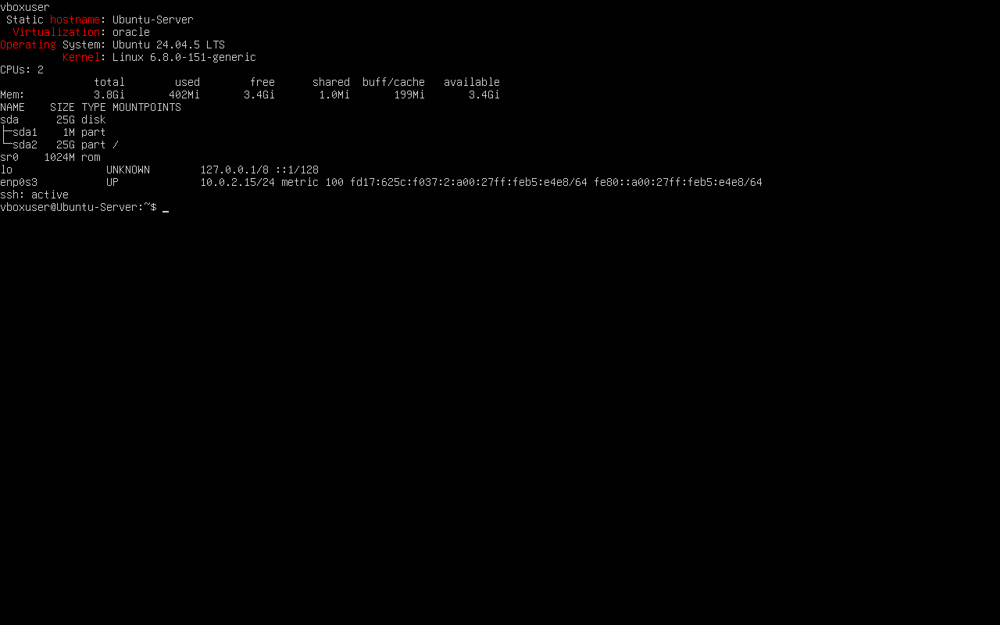

Comando usado en la consola de la VM:

```bash
whoami; hostnamectl | grep -E 'hostname|Operating|Kernel|Virtualization'; echo CPUs: $(nproc); free -h | head -2; lsblk -e7 -o NAME,SIZE,TYPE,MOUNTPOINTS; ip -br a; echo ssh: $(systemctl is-active ssh)
```

---

## 1. NAT y conexión por SSH

### Para el informe – ¿Qué es NAT?

**NAT (Network Address Translation, traducción de direcciones de red)** es una técnica por la que un equipo intermedio cambia las direcciones IP y puertos de los paquetes que pasan por él. Es lo mismo que hace el router de casa: todos los dispositivos salen a Internet con una única IP pública, y el router recuerda qué conexión pertenece a cada uno.

En VirtualBox, el modo **NAT** hace que el propio VirtualBox actúe como ese router para la máquina virtual:

- La VM recibe una IP privada (normalmente `10.0.2.15`), con puerta de enlace `10.0.2.2` y DNS `10.0.2.3`. Esa red solo existe dentro de VirtualBox.
- Cuando Ubuntu sale a Internet, VirtualBox reescribe los paquetes para que salgan como si fueran del propio Windows. Por eso la VM tiene Internet sin configurar nada.
- Lo contrario no funciona por defecto: desde Windows (o desde fuera) **no se puede iniciar una conexión** hacia la VM, porque `10.0.2.15` no es visible desde fuera de VirtualBox.

### Para el informe – Redirección de puertos

La **redirección de puertos (port forwarding)** es la regla que abre ese camino de entrada: "todo lo que llegue al puerto X del anfitrión, mándalo al puerto Y del invitado".

- **Puerto del anfitrión**: el puerto de Windows en el que VirtualBox se queda escuchando (por ejemplo `2222`). Es al que te conectas desde Windows usando `127.0.0.1`/`localhost`.
- **Puerto del invitado**: el puerto real del servicio dentro de Ubuntu (por ejemplo `22`, donde escucha OpenSSH).

Se usan puertos distintos en Windows (2222, 18069, 18080, 18443) para no chocar con servicios que ya usen 22, 80 o 443 en Windows y porque en Windows los puertos <1024 suelen necesitar permisos de administrador.

Ejemplo: `ssh -p 2222 usuario@127.0.0.1` → VirtualBox recibe en Windows:2222 → lo reenvía a Ubuntu:22 → responde OpenSSH.

### Configurar NAT y la regla SSH

Interfaz gráfica: **VM → Configuración → Red → Adaptador 1 → Conectado a: NAT → Avanzadas → Reenvío de puertos → ➕**

| Nombre | Protocolo | IP anfitrión | Puerto anfitrión | IP invitado | Puerto invitado |
|---|---|---|---|---|---|
| SSH | TCP | (vacío o 127.0.0.1) | 2222 | (vacío) | 22 |

(Alternativa desde PowerShell de Windows, con la VM apagada:)

```bash
"C:\Program Files\Oracle\VirtualBox\VBoxManage.exe" modifyvm "Ubuntu Server 24.04" --natpf1 "SSH,tcp,127.0.0.1,2222,,22"
```

Con la VM encendida se usa `controlvm` en vez de `modifyvm`:

```bash
"C:\Program Files\Oracle\VirtualBox\VBoxManage.exe" controlvm "Ubuntu Server 24.04" natpf1 "SSH,tcp,127.0.0.1,2222,,22"
```

En esta VM se crearon de una vez las cuatro reglas de la práctica (SSH y las que usan los apartados 3 y 6), todas solo en `127.0.0.1` para que no se pueda entrar desde otros equipos de la red.

📸 Adaptador 1 en NAT y tabla de reenvío:

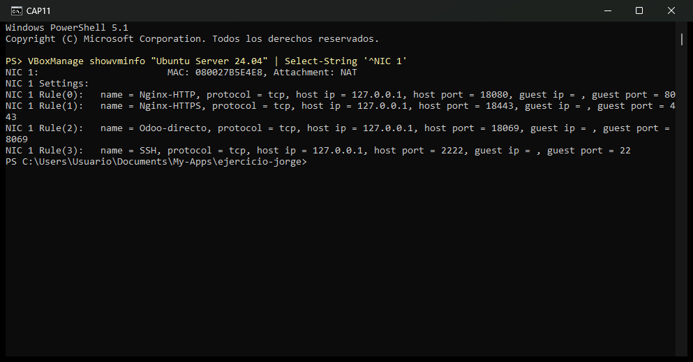

### Comprobar conectividad en Ubuntu

```bash
ip -br a
```

```bash
ip route
```

```bash
ping -c 4 8.8.8.8
```

```bash
ping -c 4 google.com
```

📸 Se ve la IP `10.0.2.15`, la ruta por defecto vía `10.0.2.2` y que los pings responden. El segundo demuestra que el DNS funciona, porque traduce `google.com` a una IP. (`ubuntu.com` no sirve para esta prueba: resuelve bien, pero sus servidores no contestan al ping.)

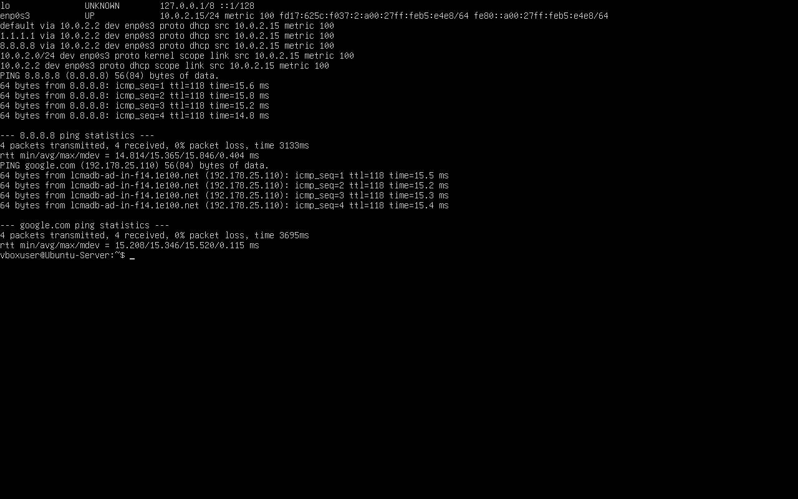

### Preparar OpenSSH

```bash
sudo apt update
```

```bash
sudo apt install -y openssh-server
```

```bash
sudo systemctl enable --now ssh
```

```bash
systemctl status ssh --no-pager
```

```bash
sudo ss -tlnp | grep :22
```

📸 Instalación y habilitación de OpenSSH (`enable` crea los enlaces para que arranque solo en cada inicio):

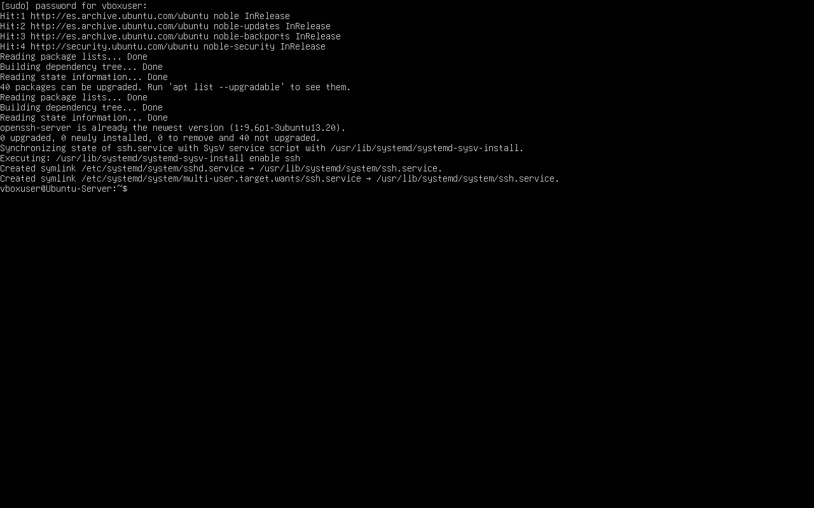

📸 Servicio `active (running)`, `enabled` y escuchando en el puerto 22 (IPv4 e IPv6):

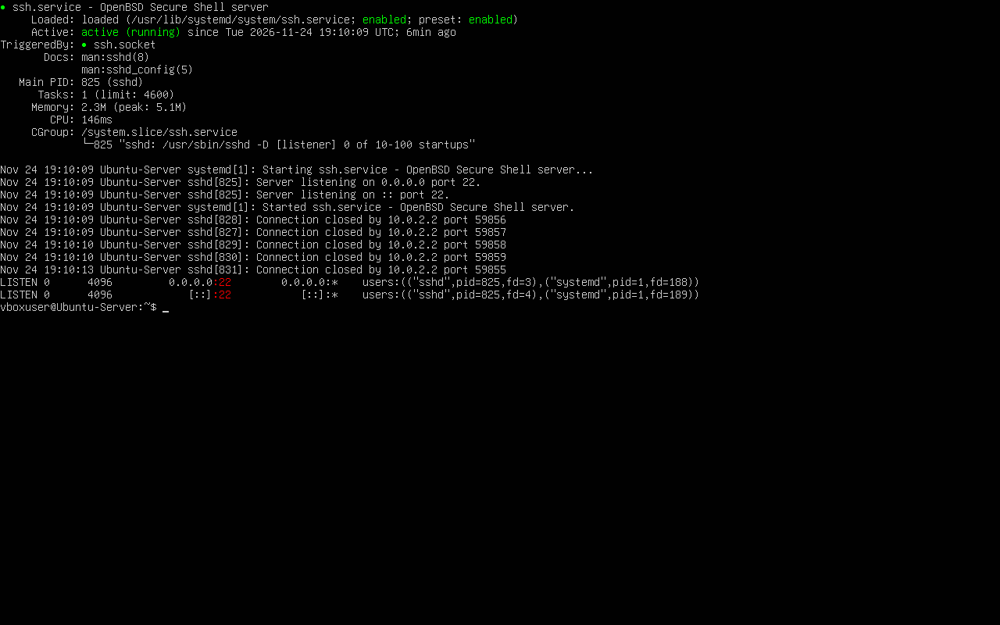

### Conectar desde Windows (PowerShell o Terminal)

```bash
ssh -p 2222 vboxuser@127.0.0.1
```

La primera vez pregunta si confías en la huella (fingerprint) del servidor → `yes`.

📸 Pregunta de la huella ED25519 del servidor:

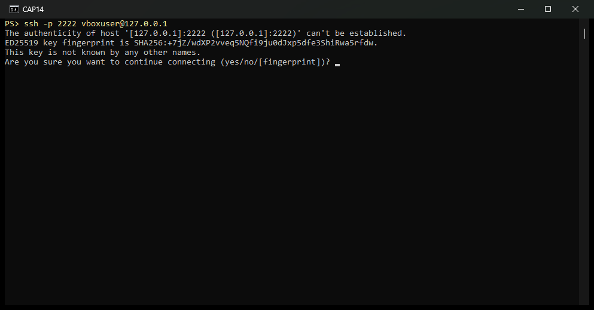

📸 Sesión SSH abierta desde Windows (el prompt `vboxuser@Ubuntu-Server` y el título de la ventana lo confirman):

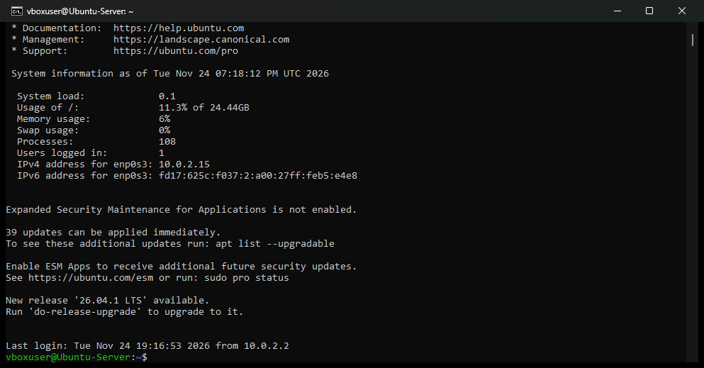

### Crear carpetas y archivos (dentro de la sesión SSH)

```bash
mkdir -p ~/ua2_p2/config ~/ua2_p2/pruebas
```

```bash
cd ~/ua2_p2/pruebas
```

```bash
printf "vboxuser\nPráctica 2 de SGE\n" > terminal.txt
```

(En la captura la «á» se escribió como `\u00e1`, que `printf` convierte en «á»: la consola de Windows no deja teclear letras con tilde dentro de SSH en algunos casos. El archivo queda igual.)

```bash
cp terminal.txt terminal_copia.txt
```

```bash
pwd && ls -l && cat terminal.txt terminal_copia.txt
```

```bash
tree ~/ua2_p2 || ls -R ~/ua2_p2
```

(`tree` no viene instalado; se instaló con `sudo apt install -y tree`. Sin él, el `|| ls -R` muestra lo mismo en forma de lista.)

📸 Terminal de Windows con la sesión SSH: carpetas, archivos y su contenido:

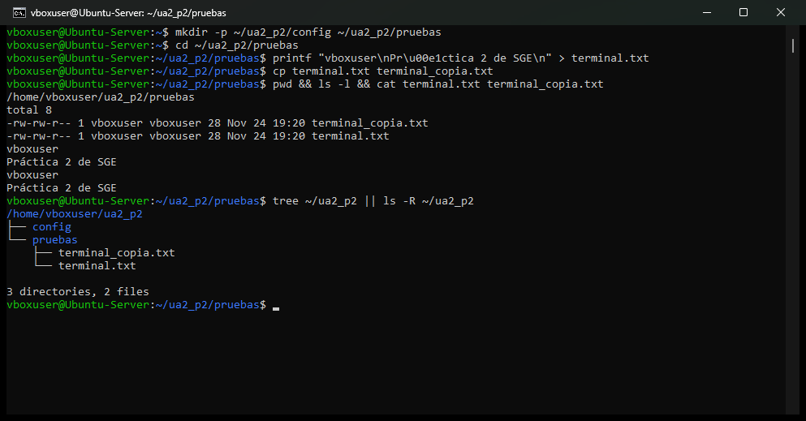

---

## 2. PostgreSQL 16 y Odoo 19 Community

> En **Ubuntu Server 24.04** el paquete `postgresql` de los repositorios oficiales es la versión 16, así que no hace falta añadir repositorios extra. Compruébalo con `lsb_release -a` (captura para el informe).

```bash
sudo apt update && sudo apt upgrade -y
```

```bash
sudo apt install -y postgresql
```

Repositorio oficial de Odoo 19 (paquetes .deb):

```bash
wget -qO- https://nightly.odoo.com/odoo.key | sudo gpg --dearmor -o /usr/share/keyrings/odoo-archive-keyring.gpg
```

```bash
echo 'deb [signed-by=/usr/share/keyrings/odoo-archive-keyring.gpg] https://nightly.odoo.com/19.0/nightly/deb/ ./' | sudo tee /etc/apt/sources.list.d/odoo.list
```

```bash
sudo apt update && sudo apt install -y odoo
```

(En la consola se lanzó todo seguido, con `DEBIAN_FRONTEND=noninteractive` para que `apt` no pare a preguntar. Tardó unos 9 minutos.)

📸 Final de la instalación: se configura `odoo (19.0.20261123)` y se crea el enlace del servicio para el arranque:

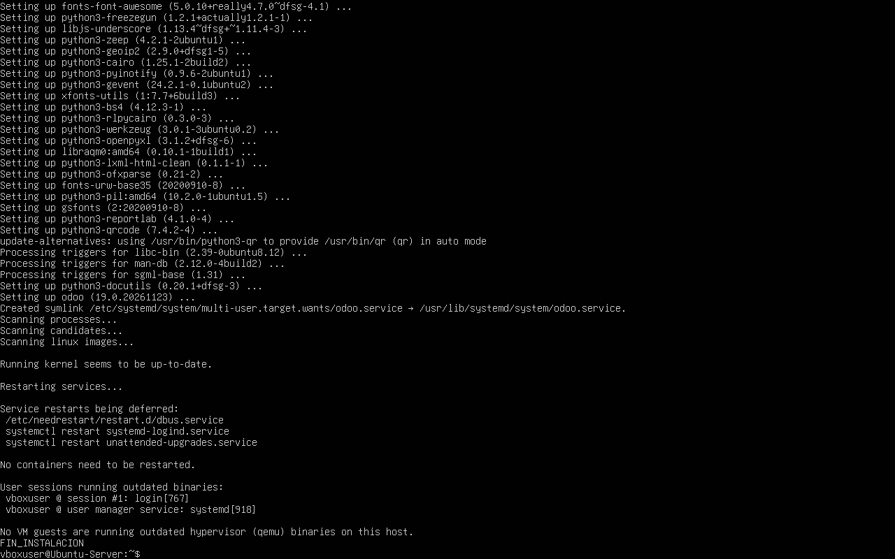

### Versiones y estado

```bash
psql --version
```

```bash
dpkg -l | grep -E "^ii\s+(odoo|postgresql-16) "
```

```bash
odoo --version
```

```bash
pg_lsclusters
```

```bash
sudo ss -tlnp | grep 5432
```

```bash
sudo systemctl enable postgresql odoo
```

```bash
systemctl is-enabled postgresql odoo
```

```bash
systemctl status odoo --no-pager
```

```bash
systemctl status postgresql@16-main --no-pager
```

```bash
sudo journalctl -u odoo -n 30 --no-pager
```

```bash
sudo journalctl -u postgresql@16-main -n 30 --no-pager
```

```bash
sudo tail -n 30 /var/log/postgresql/postgresql-16-main.log
```

```bash
sudo tail -n 30 /var/log/odoo/odoo-server.log
```

📸 Versiones: Ubuntu 24.04.5 LTS, PostgreSQL 16.15, paquetes `odoo` 19.0 y `postgresql-16` instalados (`ii`) y Odoo Server 19.0:

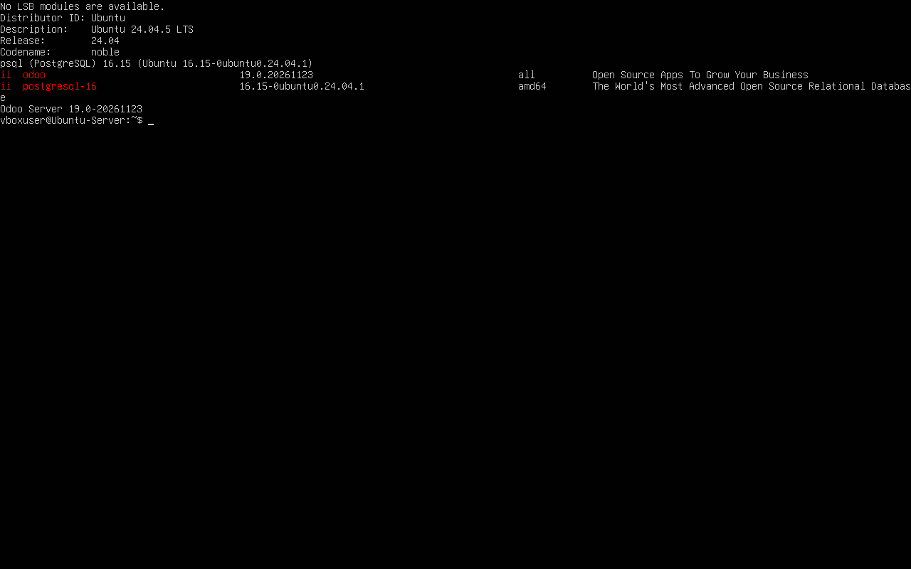

📸 `pg_lsclusters` muestra `16 main 5432 online`; PostgreSQL escucha solo en `127.0.0.1:5432`; los dos servicios quedan `enabled`:

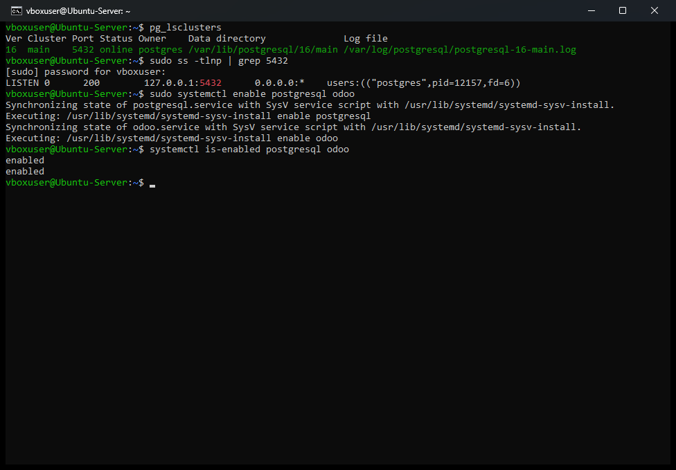

📸 Servicio de Odoo `active (running)`. En la línea del proceso se ve `--config /etc/odoo/odoo.conf --logfile /var/log/odoo/odoo-server.log`:

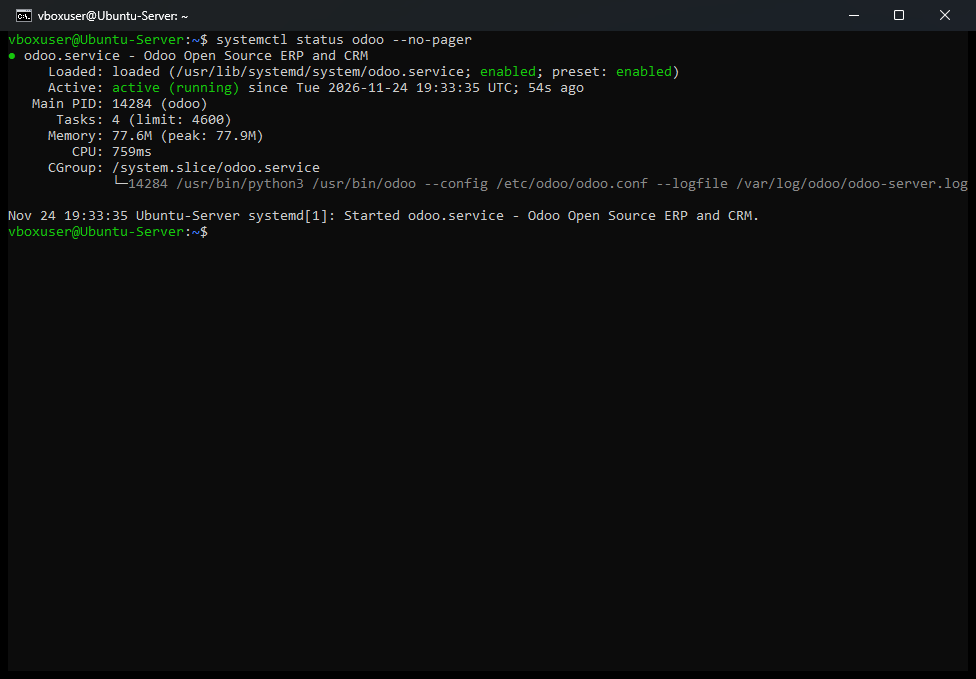

📸 Clúster de PostgreSQL `active (running)`, con dos conexiones abiertas por Odoo (`odoo postgres [local] idle`):

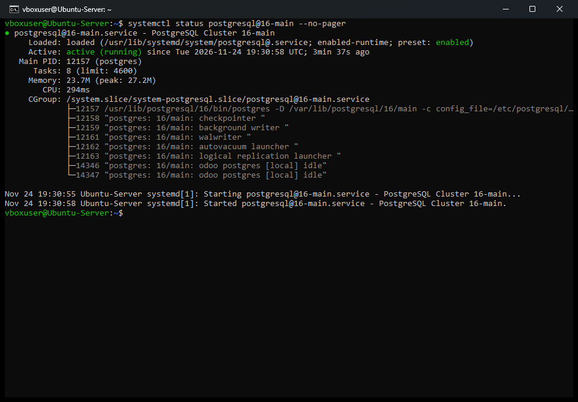

📸 `journalctl` de los dos servicios (solo arranques y paradas):

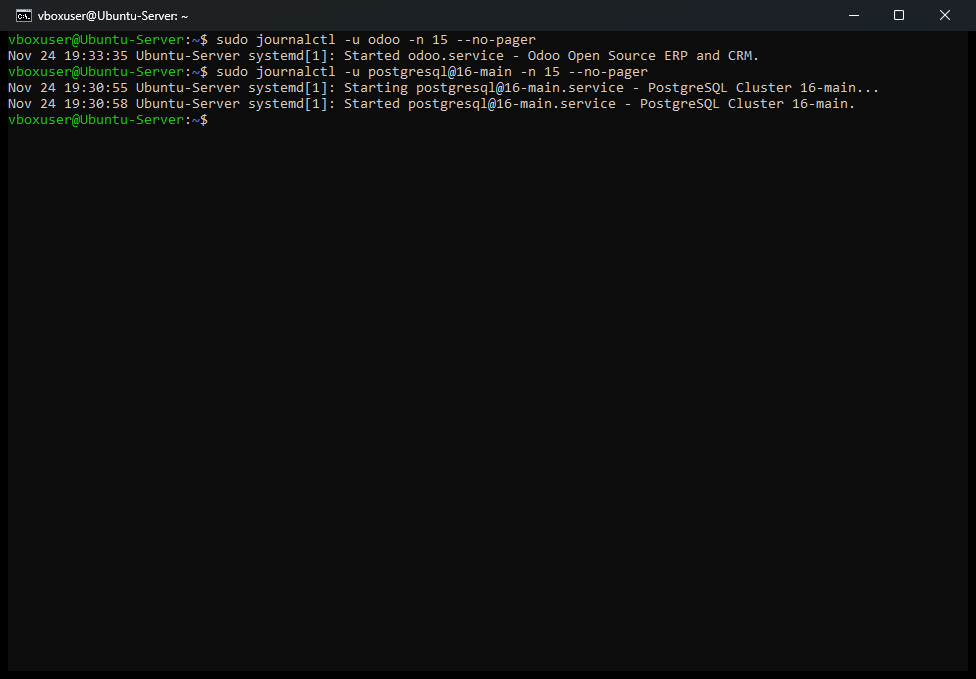

📸 Log de PostgreSQL: arranca la 16.15, escucha en `127.0.0.1:5432` y `database system is ready to accept connections`:

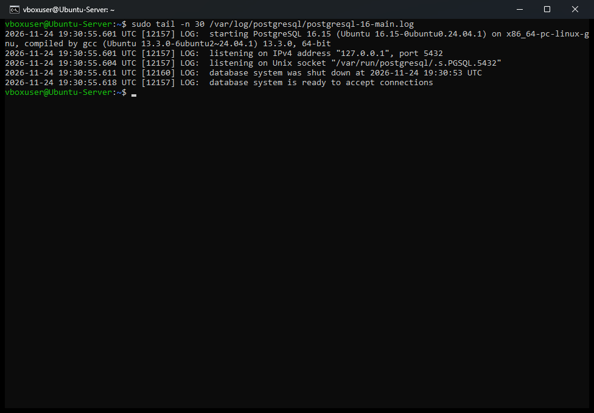

📸 Log de Odoo: versión 19.0, `/etc/odoo/odoo.conf`, conexión `odoo@default` y servidor HTTP en el puerto 8069. Las primeras peticiones `GET /web/login` llegan desde `10.0.2.2` (Windows, a través del NAT):

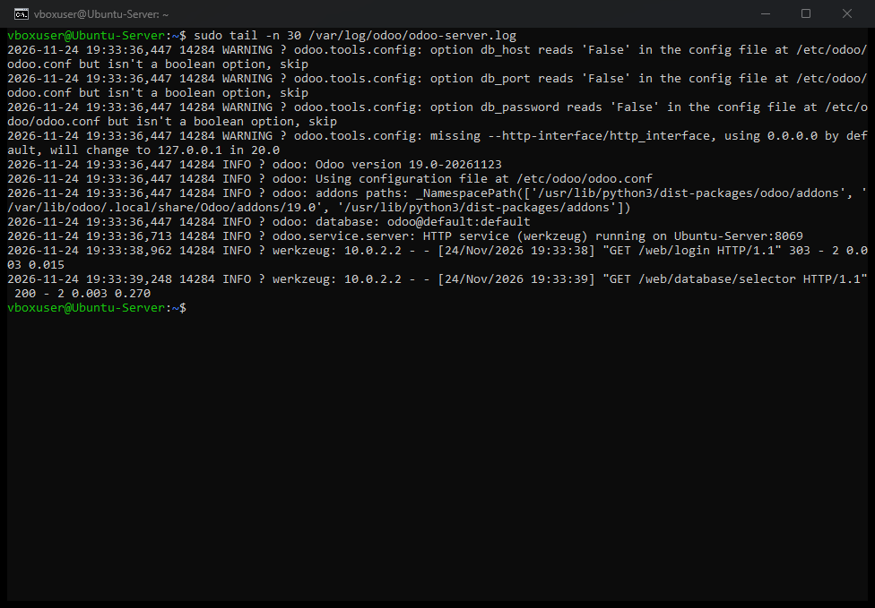

**Fíjate:** `journalctl -u odoo` muestra muy poco porque el servicio del paquete arranca Odoo con `--logfile /var/log/odoo/odoo-server.log` (lo verás en `systemctl cat odoo`). El log útil está en ese archivo.

### Error típico y cómo corregirlo

Si en el log de Odoo aparece `role "odoo" does not exist` o `FATAL: Peer authentication failed`, falta el usuario `odoo` en PostgreSQL:

```bash
sudo -u postgres psql -c "\du"
```

```bash
sudo -u postgres createuser --createdb --no-superuser --no-createrole odoo
```

```bash
sudo systemctl restart odoo && sudo tail -n 20 /var/log/odoo/odoo-server.log
```

Documenta en el informe el error, la causa y el resultado tras corregirlo (si no te sale ningún error, indícalo y muestra los logs limpios).

**Resultado en esta instalación: no hubo error.** El paquete de Odoo crea el rol `odoo` en PostgreSQL al instalarse, con permiso para crear bases de datos y sin ser superusuario:


En el log de Odoo solo hay avisos (`WARNING`), no errores:

- `db_host`, `db_port` y `db_password reads 'False'`: el `odoo.conf` del paquete trae esos valores a `False`. Odoo los ignora y usa los valores por defecto: conexión local por socket, sin contraseña, con el mismo usuario del sistema (`odoo`). Se revisa en el apartado 3.
- `missing --http-interface ... using 0.0.0.0`: Odoo escucha en todas las interfaces. Se limita a `127.0.0.1` en el apartado 3 o el 6.

---

## 3. Configurar Odoo y crear la base de datos

```bash
systemctl cat odoo | grep ExecStart
```

(Confirma que el archivo es `/etc/odoo/odoo.conf`.)

```bash
sudo cp /etc/odoo/odoo.conf /etc/odoo/odoo.conf.p2.bak
```

```bash
sudo cat /etc/odoo/odoo.conf
```

📸 Copia de seguridad `odoo.conf.p2.bak` creada y contenido original del paquete. La contraseña maestra viene comentada (`; admin_passwd = admin`):

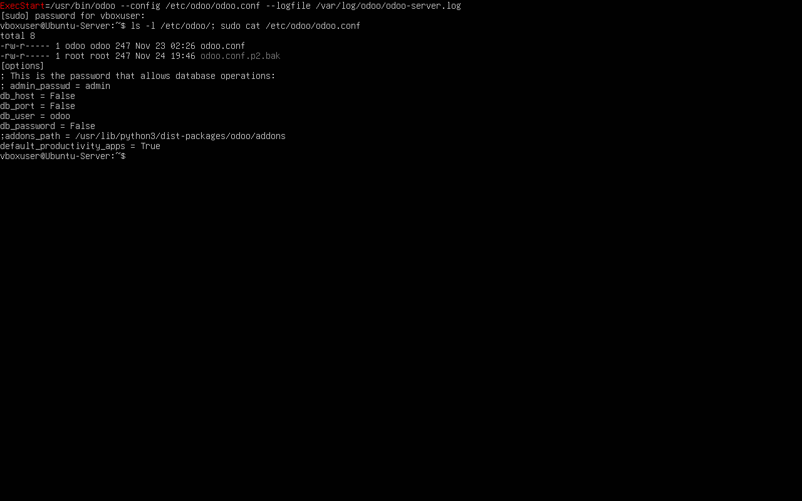

Edita:

```bash
sudo nano /etc/odoo/odoo.conf
```

Debe quedar así (los `db_*` normalmente ya vienen; no los cambies):

```ini
[options]
admin_passwd = PON_AQUI_TU_CONTRASEÑA_MAESTRA
db_host = False
db_port = False
db_user = odoo
db_password = False
http_port = 8069
log_level = info
```

`db_host = False` significa "servidor local, por socket" → usa el PostgreSQL de la misma máquina.

**No uses `admin` como contraseña maestra.** Odoo la trata como si no hubiera contraseña: el gestor de bases de datos avisa de que no está protegido y propone una contraseña aleatoria. En esta práctica se usó `MaestraSGE-2026`.

(Como alternativa a `nano`, el archivo se escribió desde la terminal con `printf '...' | sudo tee /etc/odoo/odoo.conf`, que conserva el propietario `odoo:odoo` y los permisos `640` del archivo.)

```bash
sudo systemctl restart odoo
```

```bash
sudo ss -tlnp | grep -E "8069|5432"
```

📸 Odoo en `0.0.0.0:8069`; PostgreSQL en `127.0.0.1:5432`, **no** en `0.0.0.0`. Eso confirma que PostgreSQL solo es accesible desde Ubuntu. Compruébalo también:

```bash
sudo -u postgres psql -c "SHOW listen_addresses;"
```

Para la captura, el archivo se muestra con la contraseña tapada:

```bash
sudo sed 's/^\(admin_passwd *=\).*/\1 ********/' /etc/odoo/odoo.conf
```

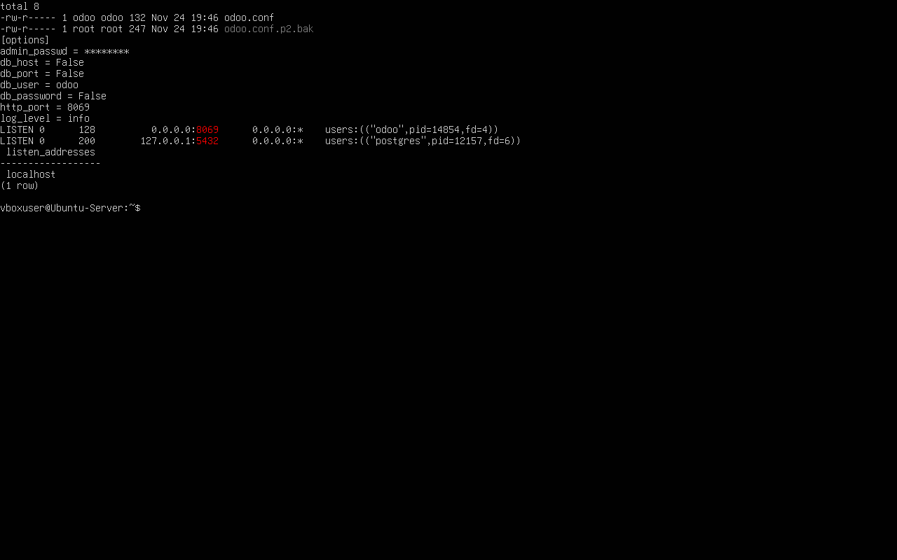

`listen_addresses = localhost` es el valor por defecto de PostgreSQL en Ubuntu: solo acepta conexiones desde la propia máquina.

### Regla NAT Odoo-directo

| Nombre | Puerto anfitrión | Puerto invitado |
|---|---|---|
| Odoo-directo | 18069 | 8069 |

(Ya creada en el apartado 1; se ve en la captura `1-1_nat_reenvio.png`.)

### UFW (reglas ANTES de activar)

```bash
sudo ufw allow 22/tcp
```

```bash
sudo ufw allow 8069/tcp
```

```bash
sudo ufw enable
```

```bash
sudo ufw status verbose
```

No se abre el 5432: PostgreSQL ya solo escucha en local y además el firewall lo bloquea (doble protección).

`ufw enable` solo pide confirmación cuando lo ejecutas desde una sesión SSH (avisa de que podría cortarla). Desde la consola de la VM se activa directamente.

📸 UFW activo y habilitado al arrancar, entrada denegada por defecto y solo 22 y 8069 permitidos. En la captura, las reglas aparecen como `Skipping adding existing rule` porque se repitió el comando para hacerla:


### Crear la base de datos

En Windows abre `http://localhost:18069`:

- Master Password: tu contraseña maestra (la de `admin_passwd`)
- Database Name: `ua2_ubuntu`
- Email: `alumno@ua2.local`
- Password: (la que quieras, apúntala)
- Language: Spanish / Español (`es_ES`) / Country: Spain
- **Demo data: desmarcado**

📸 Formulario relleno en `http://localhost:18069/web/database/manager`:

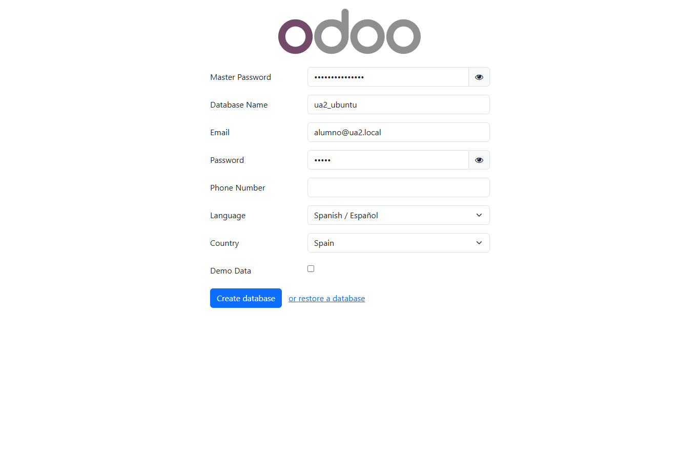

La creación tarda alrededor de un minuto. Al terminar, Odoo entra solo con la cuenta nueva. Para la captura se cerró la sesión y se volvió a entrar.

📸 Inicio de sesión con `alumno@ua2.local` (ya en español):

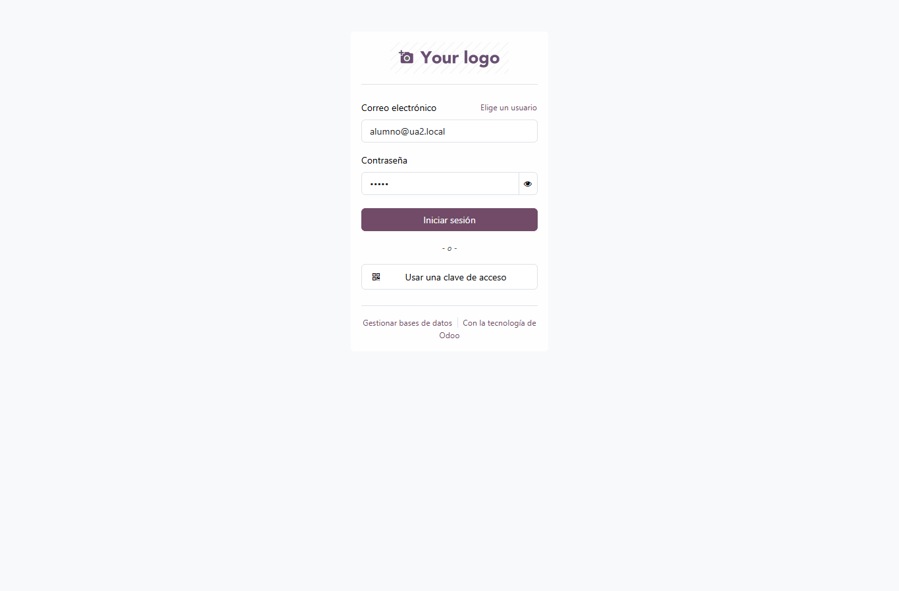

📸 Pantalla tras iniciar sesión (`/odoo/apps`, lista de aplicaciones de la base de datos `ua2_ubuntu`):

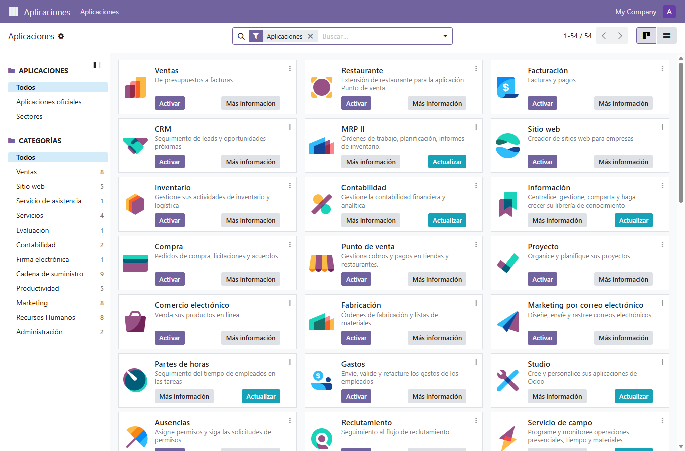

(Las capturas del navegador se hicieron con Edge sin interfaz (modo headless), así que no se ve la barra de direcciones. La dirección es la que se indica encima de cada una.)

### Para el informe – Contraseña maestra vs. contraseña del administrador

- La **contraseña maestra** (`admin_passwd` en `odoo.conf`) protege el **gestor de bases de datos** de Odoo (`/web/database/manager`): crear, duplicar, hacer copias, restaurar y **borrar** bases de datos. Es del servidor Odoo, afecta a todas las bases de datos y no sirve para iniciar sesión.
- La **contraseña de la cuenta administradora** (`alumno@ua2.local`) sirve para **iniciar sesión dentro de una base de datos concreta** (`ua2_ubuntu`) y gestionar sus datos, usuarios y aplicaciones. Se guarda (cifrada) en la tabla `res_users` de esa base de datos.

Resumen: la maestra manda sobre las bases de datos como "archivos"; la del administrador manda sobre lo que hay dentro de una de ellas.

---

## 4. Instalar Sitio web (`website`) desde la terminal

Se para el servicio para que no haya dos Odoo usando la base de datos a la vez:

```bash
sudo systemctl stop odoo
```

```bash
sudo -u odoo odoo -c /etc/odoo/odoo.conf -d ua2_ubuntu -i website --stop-after-init --logfile=
```

(`--logfile=` vacío hace que el log salga por pantalla y puedas capturar el proceso.)

```bash
sudo systemctl start odoo
```

(En la práctica se lanzaron los tres seguidos: `sudo systemctl stop odoo && sudo -u odoo odoo ... ; sudo systemctl start odoo`.)

📸 Final de la instalación: se cargan `website` y los módulos que necesita (`41 modules loaded in 20.04s`) y Odoo se para solo (`--stop-after-init`):

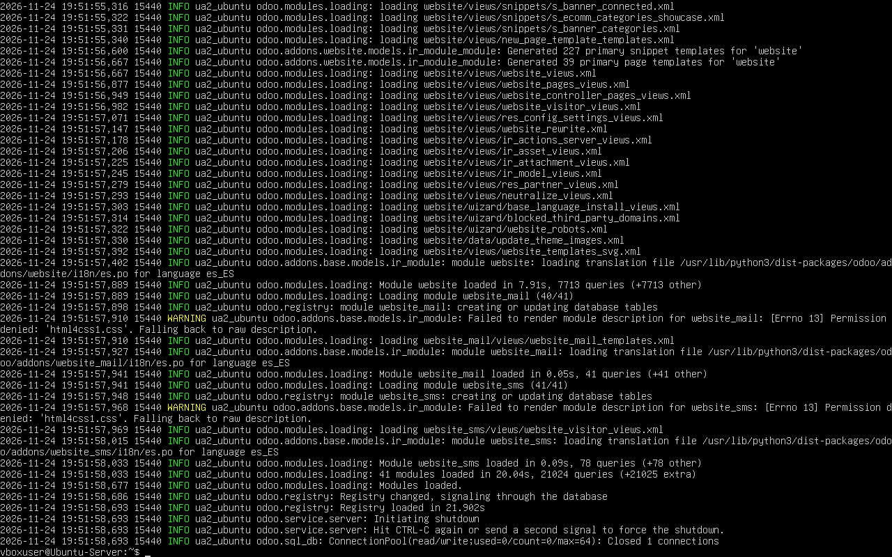

Los dos `WARNING ... Permission denied: 'html4css1.css'` no afectan a la instalación. Odoo no puede generar la descripción formateada de `website_mail` y `website_sms` y usa el texto sin formato.

Comprobar estado y dependencias:

```bash
sudo -u postgres psql -d ua2_ubuntu -c "SELECT name, state, latest_version FROM ir_module_module WHERE name='website';"
```

```bash
sudo -u postgres psql -d ua2_ubuntu -c "SELECT d.name AS depende_de, m.state FROM ir_module_module_dependency d JOIN ir_module_module m ON m.name=d.name WHERE d.module_id=(SELECT id FROM ir_module_module WHERE name='website') ORDER BY 1;"
```

📸 `website | installed | 19.0.1.0` y sus 11 dependencias directas, todas `installed`: Odoo las instala automáticamente.

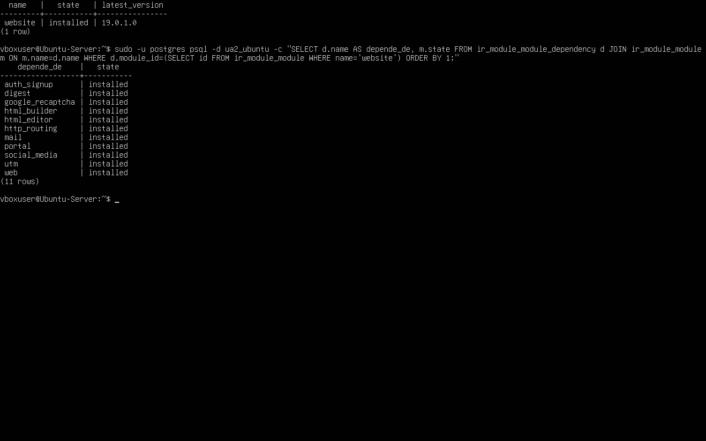

En el navegador: abre la app **Sitio web** y **Sitio web → Configuración → Ajustes**. No crees páginas.

📸 La app **Sitio web** aparece en el menú de aplicaciones. En la lista de Aplicaciones ya no tiene el botón «Activar»:

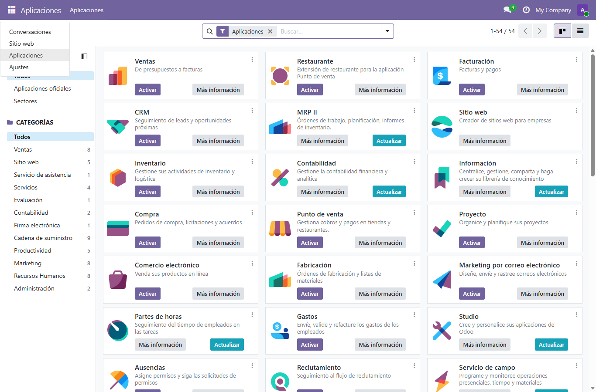

📸 **Sitio web → Configuración → Ajustes** (`http://localhost:18069/odoo/action-website.action_website_configuration`): sitio «My Website» en español y sin dominio:

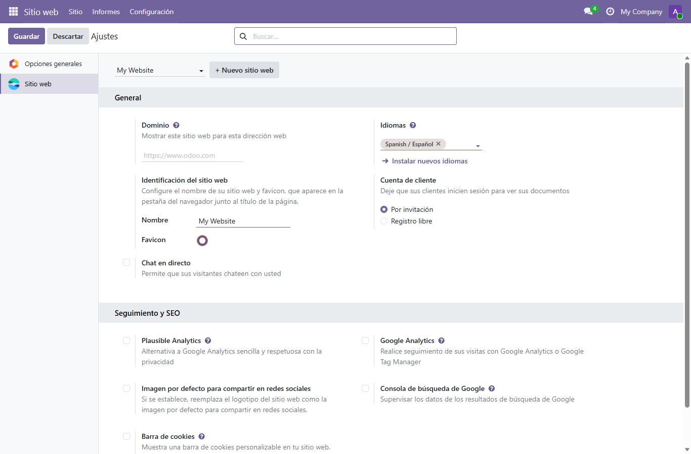

---

## 5. Archivos de la instalación

```bash
dpkg -L odoo | grep -vE "\.py$|\.pyc$|/static/|/i18n/" | head -40
```

📸 Archivos del paquete `odoo` (sin `.py`, estáticos ni traducciones): script de arranque `/etc/init.d/odoo`, rotación de logs `/etc/logrotate.d/odoo`, configuración `/etc/odoo/odoo.conf`, ejecutable `/usr/bin/odoo` y los módulos en `/usr/lib/python3/dist-packages/...`:

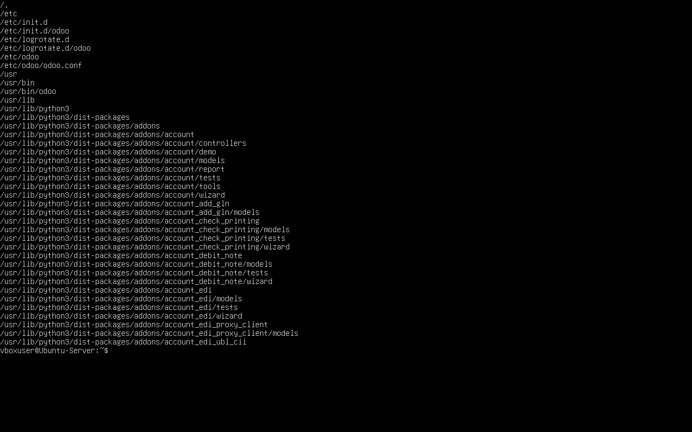

```bash
systemctl cat odoo
```

```bash
sudo cat /etc/odoo/odoo.conf
```

📸 Unidad de systemd (usuario `odoo`, `ExecStart` con `--config` y `--logfile`) y `odoo.conf` con la contraseña tapada (`sudo sed 's/^\(admin_passwd *=\).*/\1 ********/' /etc/odoo/odoo.conf`):

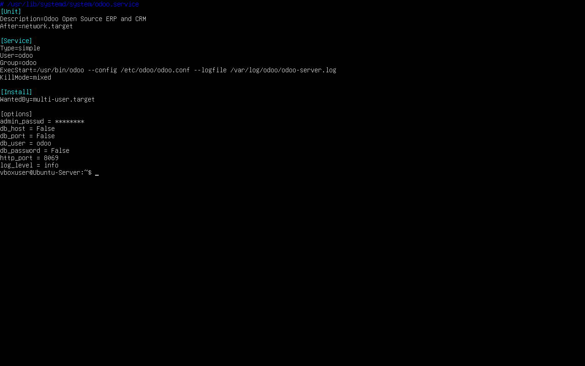

Valores efectivos de Odoo (abre una consola de Odoo):

```bash
sudo -u odoo odoo shell -c /etc/odoo/odoo.conf -d ua2_ubuntu --no-http --logfile=
```

Dentro:

```python
from odoo.tools import config
import odoo.addons
print(config['addons_path']); print(list(odoo.addons.__path__))
print(config['data_dir']); print(config['db_host'], config['db_port'], config['db_user'])
exit()
```

En Odoo 19, `config['addons_path']` sale **vacío** (`[]`) porque `odoo.conf` no define esa opción. Las carpetas que Odoo usa de verdad están en `odoo.addons.__path__`.

(Para la captura, el código se pasó a `odoo shell` por la entrada estándar con `printf '...' |` y se añadió `--log-level=error` para quitar los avisos.)

📸 Valores efectivos:

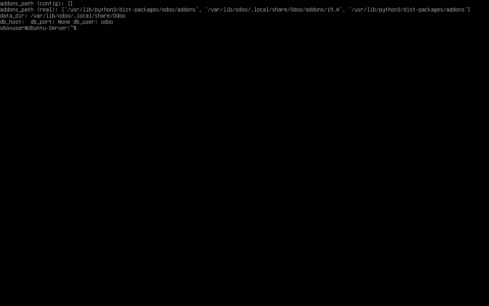

Conexiones activas de Odoo en PostgreSQL:

```bash
sudo -u postgres psql -c "SELECT usename, datname, client_addr, client_port FROM pg_stat_activity WHERE usename='odoo';"
```

📸 Todas las conexiones del usuario `odoo` tienen `client_addr` vacío y `client_port = -1`: son conexiones por **socket Unix**, no por TCP:


PostgreSQL:

```bash
sudo -u postgres psql -c "SHOW config_file;" -c "SHOW data_directory;" -c "SHOW port;" -c "SHOW listen_addresses;" -c "SHOW unix_socket_directories;" -c "SHOW hba_file;"
```

```bash
sudo grep -vE '^\s*(#|$)' /etc/postgresql/16/main/pg_hba.conf
```

📸 Rutas y parámetros de PostgreSQL, y reglas activas de `pg_hba.conf` (`local all all peer`):

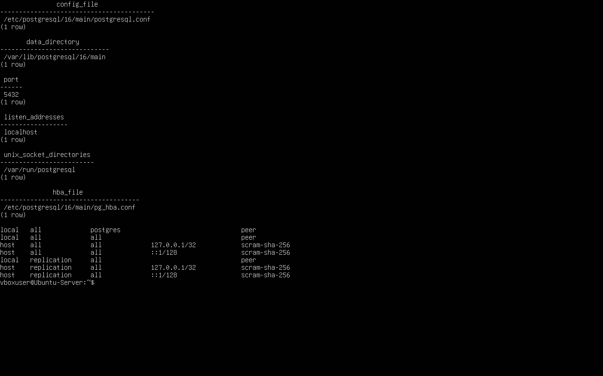

### Para el informe – Respuestas

**a) db_host, db_port, db_user, db_password. ¿Socket o TCP?**
En `/etc/odoo/odoo.conf`: `db_host = False`, `db_port = False`, `db_user = odoo`, `db_password = False` (no hay contraseña; si la tuvieras, no la copies). Odoo avisa en el log de que `'False'` no es un valor válido para esas opciones y las ignora. Por eso los valores efectivos son `db_host` vacío y `db_port = None` (captura 5-3). Al no indicar host, la librería de conexión (psycopg2) no usa TCP sino el **socket local de Unix** en `/var/run/postgresql` (lo confirma `SHOW unix_socket_directories`). Lo he comprobado con `pg_stat_activity`: las 11 conexiones del usuario `odoo` tienen `client_addr` **vacío** y `client_port = -1`, que es lo que aparece en las conexiones por socket (por TCP aparecería `127.0.0.1` y un puerto). Como no hay contraseña, PostgreSQL autentica por *peer*: comprueba que el usuario del sistema (`odoo`) coincide con el rol de la base de datos (regla `local all all peer` en `pg_hba.conf`).

**b) addons_path y data_dir**
- `addons_path`: carpetas donde Odoo busca módulos (aplicaciones). En esta instalación son tres: `/usr/lib/python3/dist-packages/odoo/addons` (módulos base del paquete), `/var/lib/odoo/.local/share/Odoo/addons/19.0` (módulos que se añadan desde la interfaz) y `/usr/lib/python3/dist-packages/addons` (el resto de aplicaciones del paquete).
- `data_dir`: carpeta donde Odoo guarda datos que no van a la base de datos (filestore, sesiones). No aparece en `odoo.conf`, así que se usa el valor por defecto `~/.local/share/Odoo` del usuario `odoo`, cuyo home es `/var/lib/odoo` → **`/var/lib/odoo/.local/share/Odoo`**.

**c) Filestore de ua2_ubuntu**

```bash
sudo ls -la /var/lib/odoo/.local/share/Odoo/filestore/ua2_ubuntu | head
```

```bash
sudo du -sh /var/lib/odoo/.local/share/Odoo/filestore/ua2_ubuntu
```

```bash
sudo -u postgres psql -d ua2_ubuntu -c "SELECT id, name, mimetype, store_fname FROM ir_attachment WHERE store_fname IS NOT NULL LIMIT 5;"
```

📸 Filestore: subcarpetas de 2 caracteres, 19 MB en total, y fichas de `ir_attachment` cuyo `store_fname` apunta a esos archivos:

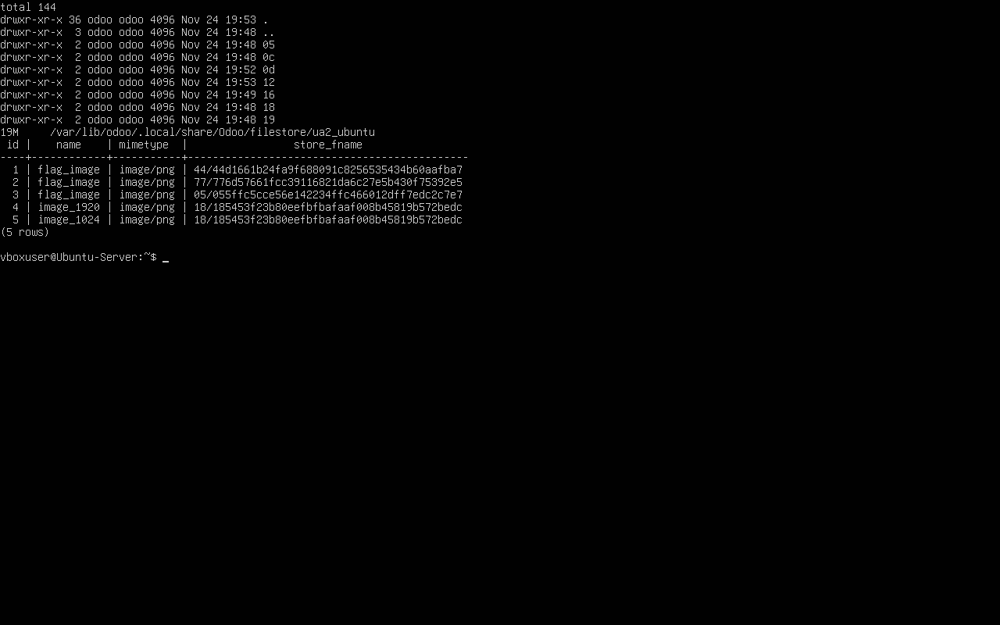

Está en `/var/lib/odoo/.local/share/Odoo/filestore/ua2_ubuntu`. Guarda los **archivos binarios** (adjuntos, imágenes, logos, CSS/JS compilados de la web…). Tiene subcarpetas de 2 caracteres (`3a/`, `f1/`…) y dentro archivos cuyo nombre es su **huella SHA-1**. La base de datos no guarda el archivo, solo una ficha en la tabla `ir_attachment` cuyo campo `store_fname` (p. ej. `3a/3a9f…`) apunta al archivo. Por eso una copia de seguridad necesita **las dos partes**: base de datos + filestore. Si falta una, se pierden imágenes y adjuntos.

**d) Logs de Odoo**
En `/var/log/odoo/odoo-server.log` (lo fija `--logfile` en `ExecStart` de `systemctl cat odoo`), con nivel `info` (`log_level = info`).

```bash
sudo tail -n 15 /var/log/odoo/odoo-server.log
```

📸 Últimas líneas del log:

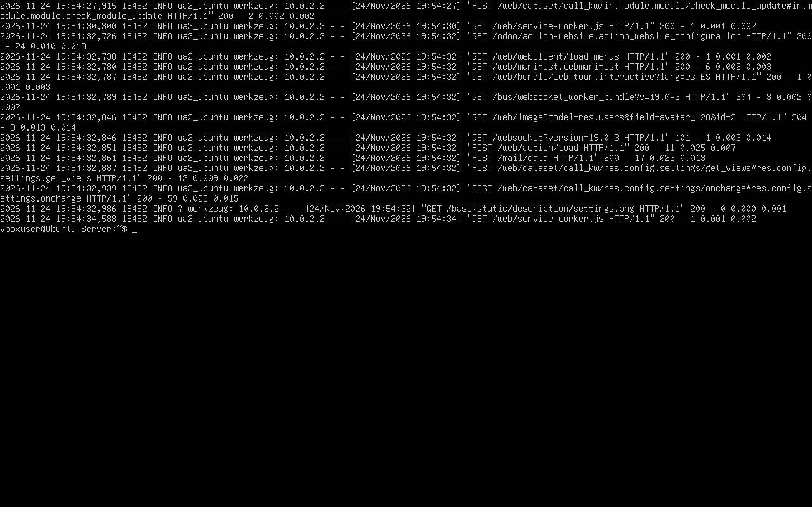

Interpretación de una línea real de la captura:
`2026-11-24 19:54:32,726 15452 INFO ua2_ubuntu werkzeug: 10.0.2.2 - - [24/Nov/2026 19:54:32] "GET /odoo/action-website.action_website_configuration HTTP/1.1" 200 - 24 0.010 0.013`
→ **Fecha/hora** `2026-11-24 19:54:32,726` (en UTC) · **PID** 15452 (proceso de Odoo) · **Nivel** `INFO` · **BD** `ua2_ubuntu` · **origen** `werkzeug` (servidor web interno) · **Mensaje**: petición `GET` a los ajustes de Sitio web desde `10.0.2.2` (el NAT de VirtualBox, o sea, Windows), respuesta `200` (correcta). Los tres números finales son las consultas SQL (24), el tiempo en la base de datos (0,010 s) y el tiempo restante de procesamiento (0,013 s).

**e) website/__manifest__.py**

```bash
sudo cat /usr/lib/python3/dist-packages/odoo/addons/website/__manifest__.py | head -40
```

📸 Manifiesto de `website`:

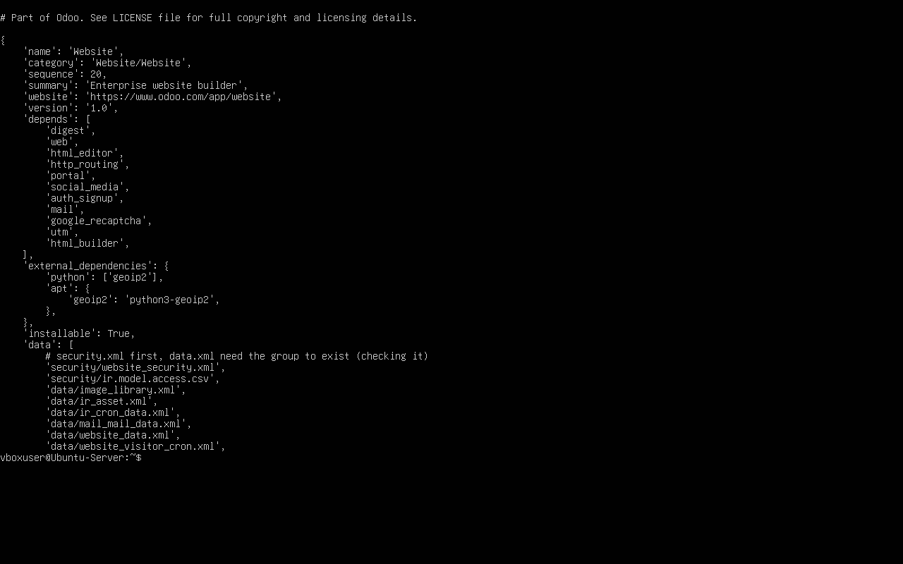

Valores reales: `name: 'Website'`, `category: 'Website/Website'`, `version: '1.0'` (Odoo la muestra como `19.0.1.0`), `depends` con 11 módulos: `digest`, `web`, `html_editor`, `http_routing`, `portal`, `social_media`, `auth_signup`, `mail`, `google_recaptcha`, `utm` y `html_builder` (los mismos de la captura 4-2). Necesita además la librería Python `geoip2` (paquete `python3-geoip2`). Los dos primeros de `data` son de **seguridad** (`security/website_security.xml` y `security/ir.model.access.csv`). Odoo los carga primero para crear los grupos, las reglas y los **permisos de acceso a los modelos** antes que las vistas, menús y datos que dependen de ellos. El propio manifiesto lo explica en un comentario: «security.xml first, data.xml need the group to exist».

---

## 6. Nginx y HTTPS

### Fase HTTP

```bash
sudo apt install -y nginx
```

```bash
sudo systemctl enable --now nginx
```

📸 Instalación de Nginx 1.24 y habilitación del servicio:

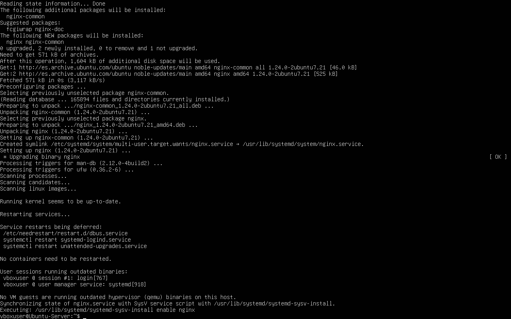

En `odoo.conf` añade:

```ini
proxy_mode = True
```

```bash
sudo systemctl restart odoo
```

Crea el sitio a partir de la plantilla `odoo_ua2` del profesor. Una versión completa está en `config/odoo-ua2.nginx.conf` de este repositorio. En la **primera fase** usa un único `server { listen 80; ... }` con las `location` del bloque 443 (sin `ssl_*` ni `return 301`). Esa versión está en `config/odoo-ua2-http.nginx.conf`.

(En la práctica, en lugar de `nano`, el archivo se escribió desde la consola con un *heredoc*: `sudo tee /etc/nginx/sites-available/odoo-ua2 > /dev/null <<'EOF'` … `EOF`. Las tildes de los comentarios se quitaron porque el teclado de la consola está en inglés.)

```bash
sudo nano /etc/nginx/sites-available/odoo-ua2
```

```bash
sudo ln -s /etc/nginx/sites-available/odoo-ua2 /etc/nginx/sites-enabled/odoo-ua2
```

```bash
sudo rm /etc/nginx/sites-enabled/default
```

```bash
sudo nginx -t
```

```bash
sudo systemctl reload nginx
```

```bash
sudo ufw allow 80/tcp
```

📸 `odoo.conf` con `proxy_mode = True`, sitio enlazado en `sites-enabled` (sin `default`), `nginx -t` correcto y puerto 80 abierto en UFW:

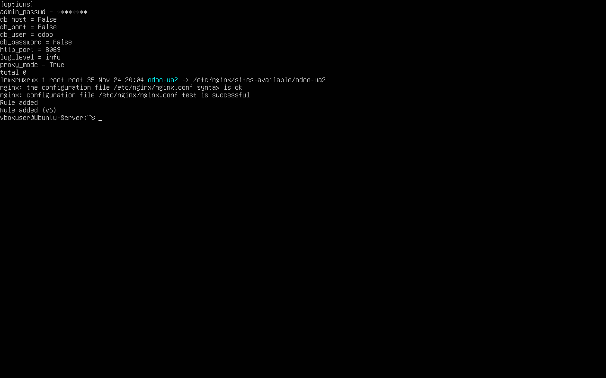

📸 Sitio de la fase HTTP:

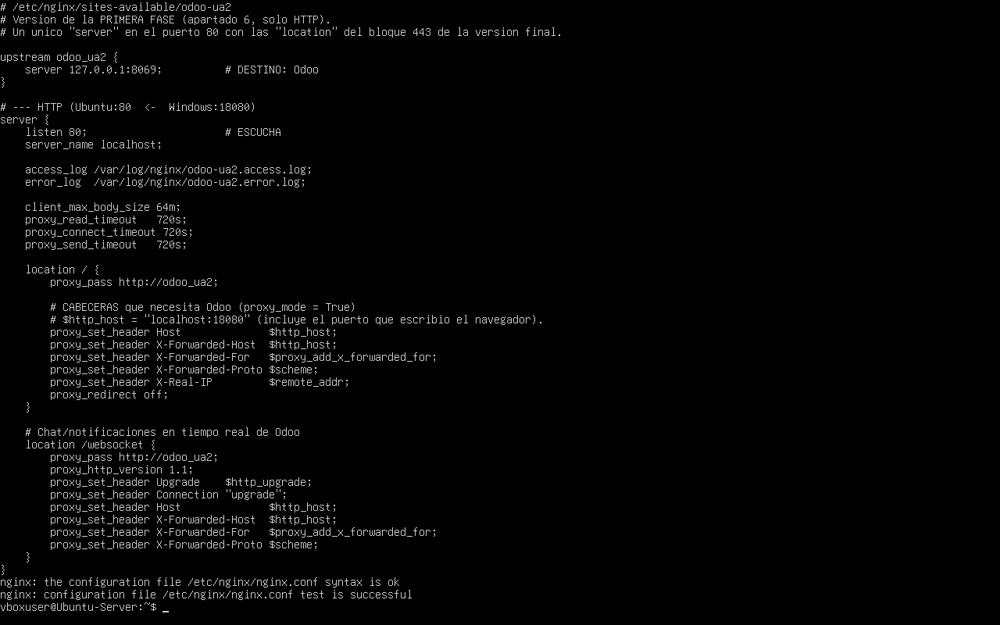

Regla NAT **Nginx-HTTP**: 18080 → 80 (ya creada en el apartado 1). Abre `http://localhost:18080`, inicia sesión y navega: la URL debe seguir con `:18080`.

📸 Inicio de sesión en `localhost:18080/web/login` (Odoo a través de Nginx):

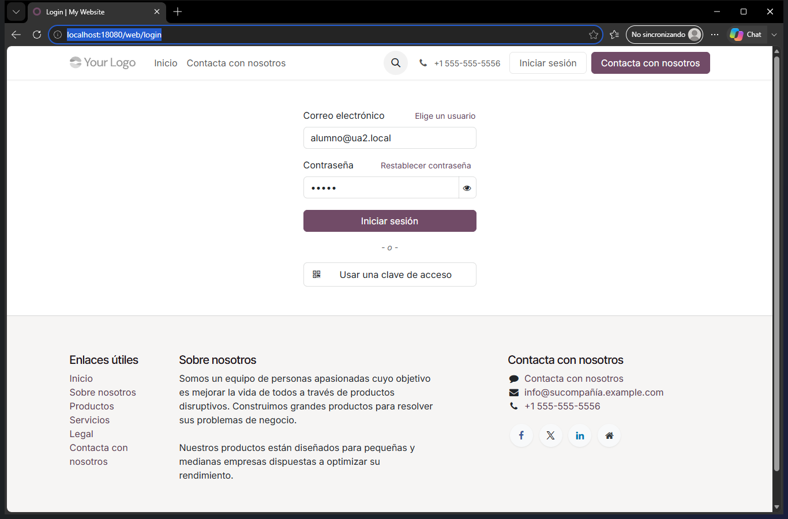

📸 Tras iniciar sesión y navegar a los ajustes de Sitio web, la URL sigue con `:18080`:

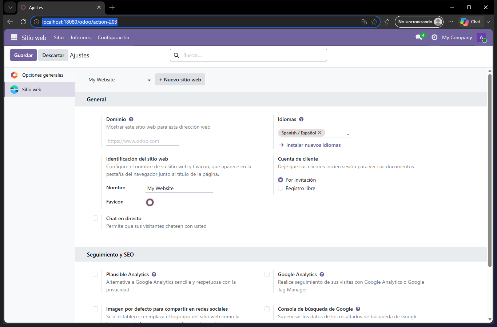

### Para el informe – Escucha, destino y cabeceras

- **Escucha**: `listen 80;` / `listen 443 ssl;` con `server_name localhost;`.
- **Destino**: `proxy_pass http://127.0.0.1:8069;` (vía `upstream`).
- **Cabeceras**: `Host $http_host` y `X-Forwarded-Host $http_host` (nombre **y puerto** que escribió el navegador, p. ej. `localhost:18080`), `X-Forwarded-Proto $scheme` (http o https), `X-Forwarded-For` / `X-Real-IP` (IP real del cliente). Con `proxy_mode = True` Odoo confía en estas cabeceras para construir sus URLs y redirecciones. Si se usara `$host` en vez de `$http_host`, se perdería el puerto 18080 y Odoo redirigiría a `http://localhost/…`, que en Windows no existe.

### Certificado autofirmado

```bash
sudo openssl req -x509 -nodes -newkey rsa:2048 -days 30 -keyout /etc/ssl/private/odoo-ua2.key -out /etc/ssl/certs/odoo-ua2.crt -subj "/CN=localhost" -addext "subjectAltName=DNS:localhost,IP:127.0.0.1"
```

```bash
sudo chmod 600 /etc/ssl/private/odoo-ua2.key
```

```bash
openssl x509 -in /etc/ssl/certs/odoo-ua2.crt -noout -subject -issuer -dates -ext subjectAltName
```

📸 Clave privada con permisos `600` (solo root), y certificado con sujeto y emisor `CN = localhost`, 30 días de validez y SAN `DNS:localhost, IP Address:127.0.0.1`:

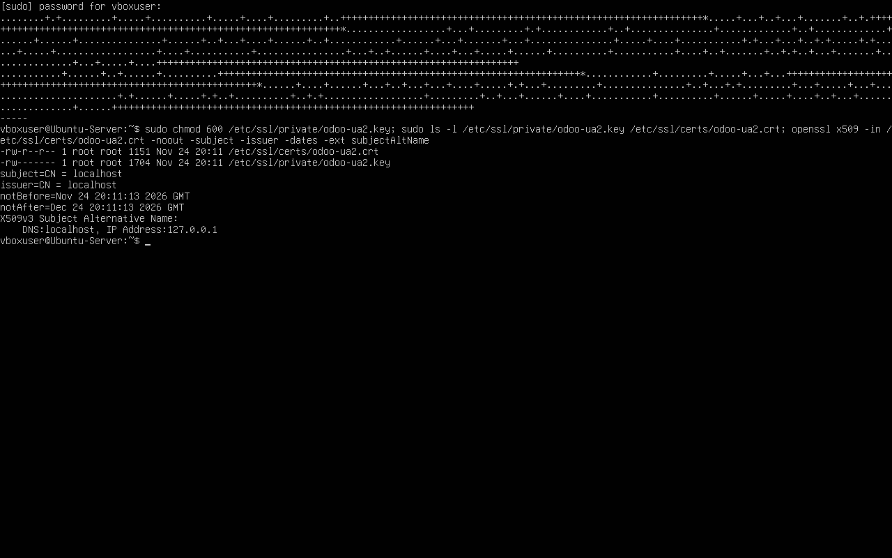

### Fase HTTPS

Sustituye el sitio por la versión completa de `config/odoo-ua2.nginx.conf`.

📸 Sitio final (parte inferior; arriba quedan el `upstream` y el `server` del 80 con `return 301`):

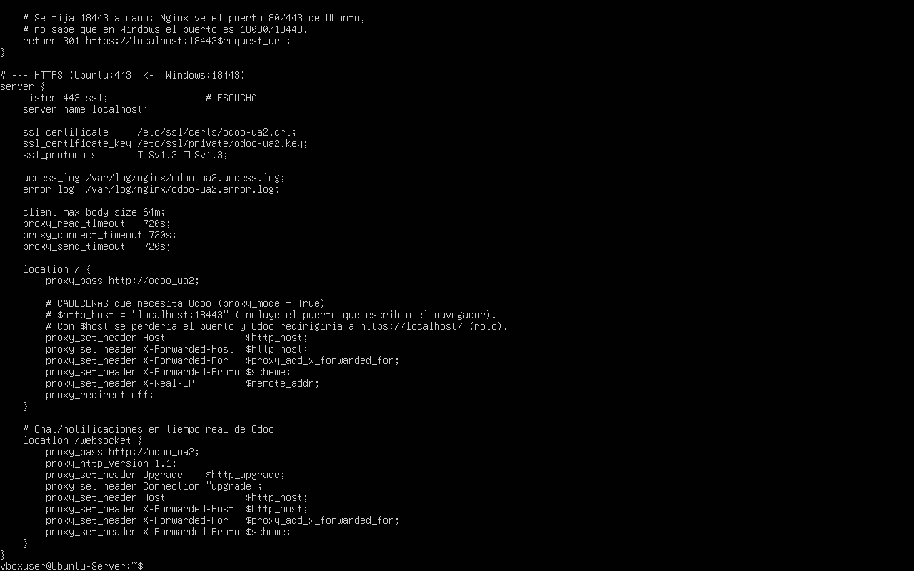

```bash
sudo nginx -t && sudo systemctl reload nginx
```

```bash
sudo ufw allow 443/tcp
```

```bash
sudo ufw status numbered
```

📸 `nginx -t` correcto, puerto 443 añadido y reglas numeradas de UFW:

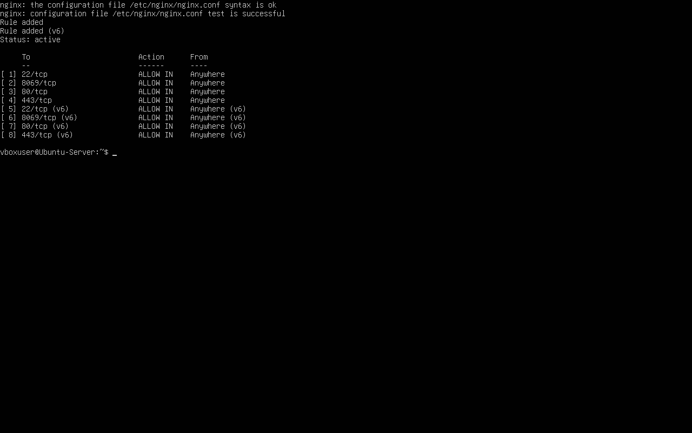

Regla NAT **Nginx-HTTPS**: 18443 → 443 (ya creada en el apartado 1).

Pruebas:
- `https://localhost:18443` → aviso de seguridad → Avanzado → Continuar. Inicia sesión y navega.
- `http://localhost:18080/odoo/contacts` → debe acabar en `https://localhost:18443/odoo/contacts` (misma ruta). En esta base de datos no está instalada la app Contactos, así que se probó con `/odoo/apps`, que conserva la ruta igual.
- Candado/aviso → Ver certificado: CN `localhost`, emisor `localhost` (el mismo, por ser autofirmado), validez 30 días, SAN `DNS:localhost, IP:127.0.0.1`.

📸 Aviso del navegador: `NET::ERR_CERT_AUTHORITY_INVALID`:

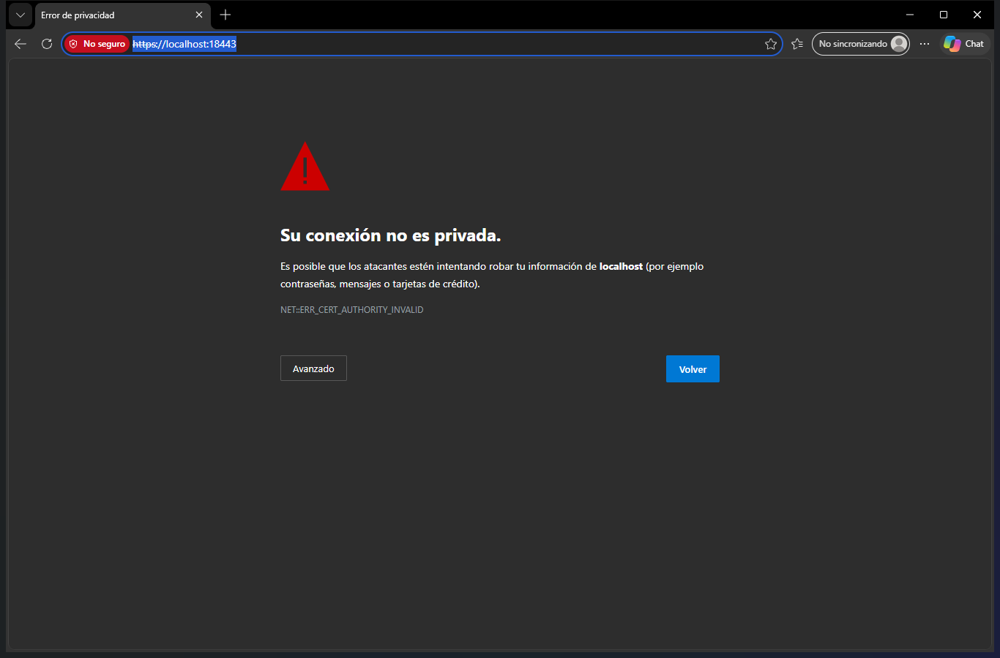

📸 Avanzado → «Continuar a localhost (no seguro)»:

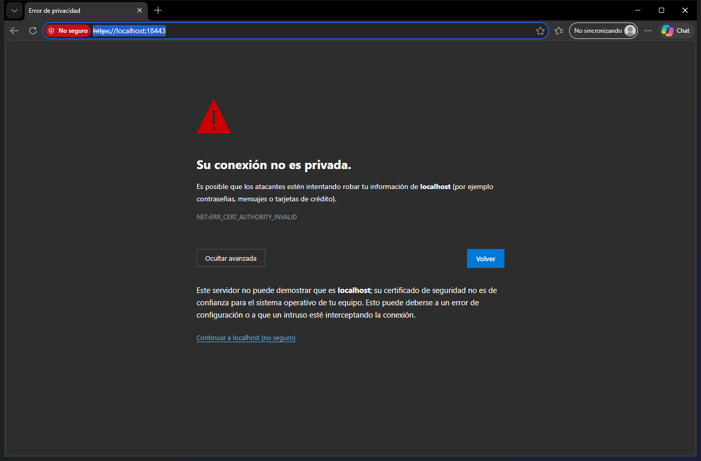

📸 Sesión iniciada y navegando por `https://localhost:18443` (el candado aparece como «No seguro» por el certificado autofirmado, pero la conexión va cifrada):

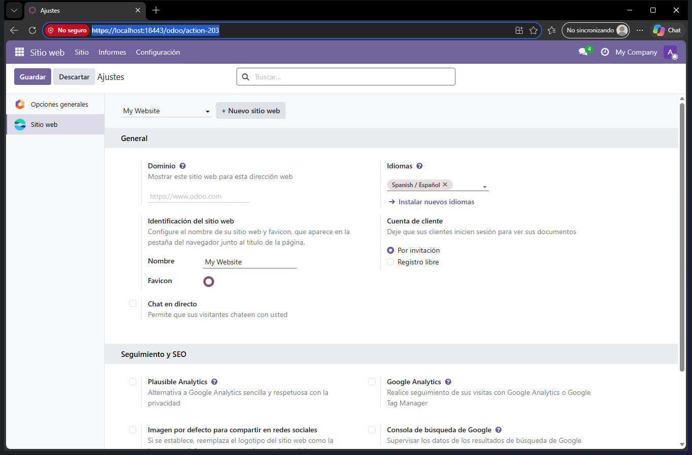

📸 Al abrir `http://localhost:18080/odoo/apps`, Nginx responde `301` y el navegador termina en `https://localhost:18443/odoo/apps`, con la misma ruta:

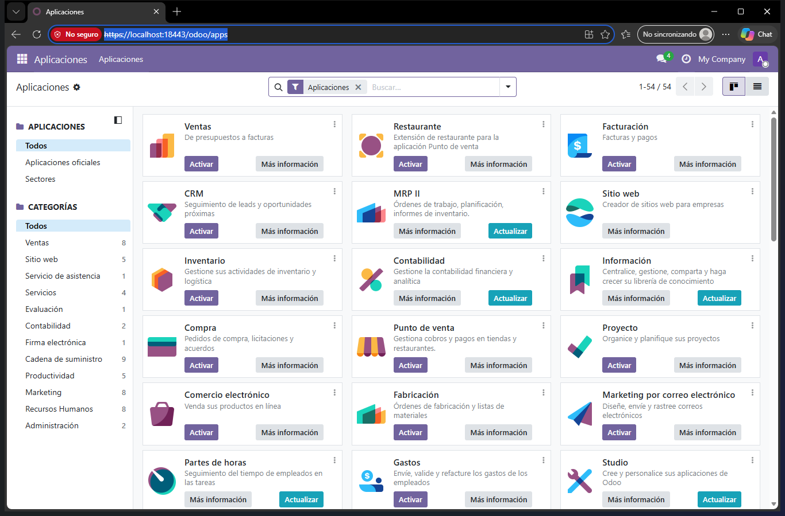

📸 Datos del certificado vistos desde Windows (en lugar del visor del navegador, se leyeron con PowerShell conectando a `localhost:18443`). Coinciden con los de Ubuntu: sujeto y emisor `CN=localhost`, 30 días, SAN `localhost` / `127.0.0.1`, TLS 1.3. Windows no confía en él (`UntrustedRoot`) porque no lo firma ninguna CA:

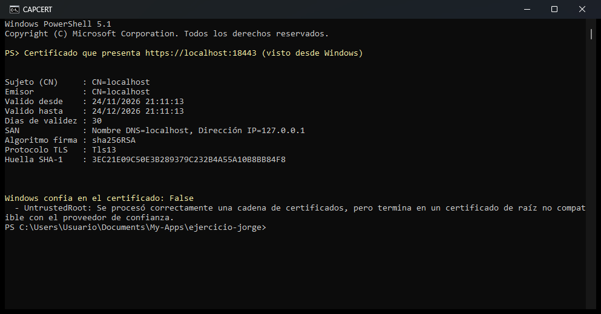

### Para el informe – Aviso del certificado autofirmado

El navegador solo confía en certificados firmados por una **autoridad de certificación (CA)** que tiene en su lista de confianza. Un certificado autofirmado está firmado por sí mismo (emisor = sujeto), así que el navegador no puede comprobar que quien lo presenta es quien dice ser y muestra el aviso (`NET::ERR_CERT_AUTHORITY_INVALID`). **El cifrado funciona igual**: los datos viajan cifrados; lo que falta es la garantía de identidad. En un entorno de prácticas es aceptable; en producción se usaría una CA (p. ej. Let's Encrypt).

### Estado y logs de Nginx

```bash
systemctl status nginx --no-pager
```

```bash
sudo tail -n 20 /var/log/nginx/odoo-ua2.access.log
```

```bash
sudo tail -n 20 /var/log/nginx/odoo-ua2.error.log
```

📸 Nginx `active (running)` y `enabled`, con el proceso maestro y dos procesos *worker*:

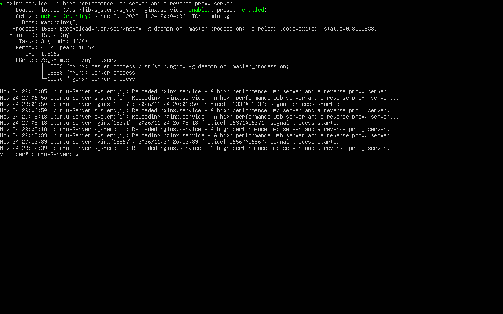

📸 Log de acceso. Arriba, peticiones HTTPS del sitio `odoo-ua2`. Abajo, los `301` del puerto 80: el bloque del 80 no define `access_log` propio, así que se registran en el log general `/var/log/nginx/access.log`:

```bash
sudo grep -E '"(GET|POST) /(odoo|web/login)' /var/log/nginx/odoo-ua2.access.log | tail -n 8
```

```bash
sudo grep ' 301 ' /var/log/nginx/access.log | tail -n 4
```

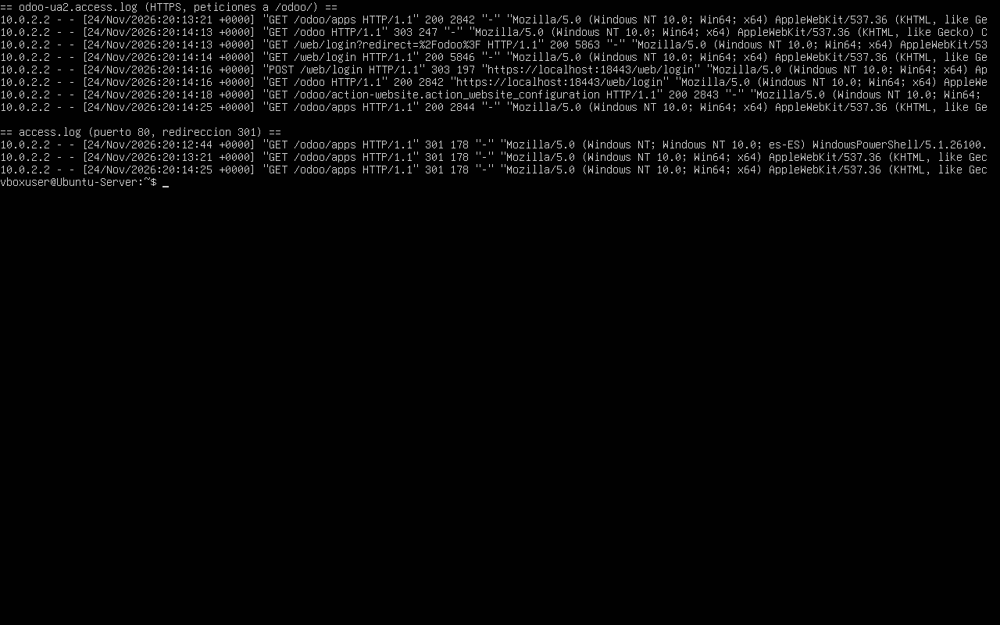

📸 Log de errores del sitio: vacío (0 líneas), no hubo ningún error:


Interpretación de una línea real:
`10.0.2.2 - - [24/Nov/2026:20:14:16 +0000] "POST /web/login HTTP/1.1" 303 197 "https://localhost:18443/web/login" "Mozilla/5.0 (Windows NT 10.0; Win64; x64) ..."`
→ cliente `10.0.2.2` (Windows a través del NAT de VirtualBox), fecha en UTC, método `POST` a `/web/login` (envío del formulario de inicio de sesión), código `303` (Odoo redirige tras un inicio de sesión correcto), 197 bytes, página de origen (*referer*) `https://localhost:18443/web/login` y navegador de Windows. En `access.log` aparece `"GET /odoo/apps HTTP/1.1" 301 178`: es la redirección del puerto 80 a HTTPS.

### Cerrar el acceso directo a Odoo

En `odoo.conf`:

```ini
http_interface = 127.0.0.1
```

```bash
sudo systemctl restart odoo
```

```bash
sudo ss -tlnp | grep 8069
```

(Ahora debe verse `127.0.0.1:8069`, no `0.0.0.0:8069`.)

```bash
sudo ufw delete allow 8069/tcp
```

```bash
sudo ufw status
```

📸 `http_interface = 127.0.0.1` en `odoo.conf`, Odoo escuchando solo en `127.0.0.1:8069`, regla 8069 borrada y UFW con 22, 80 y 443:

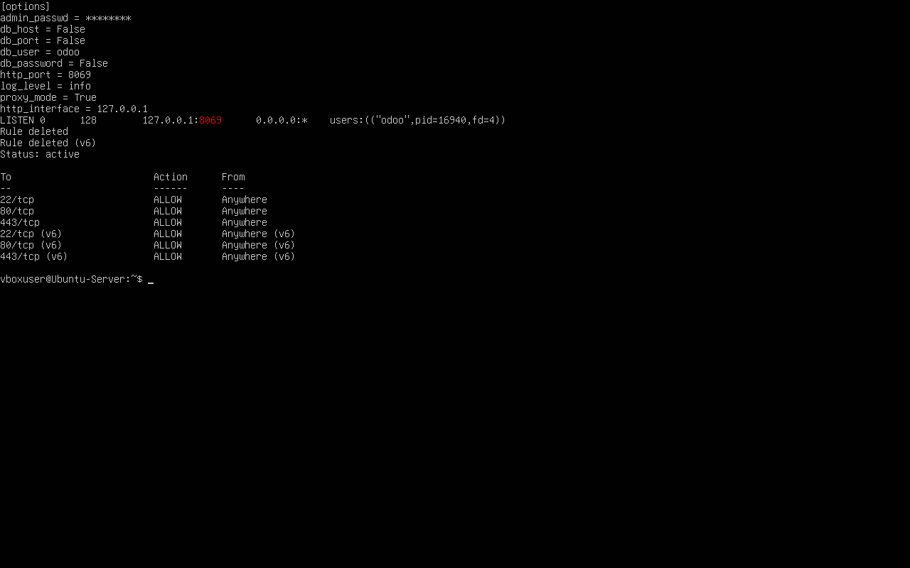

Borra la regla NAT **Odoo-directo** en VirtualBox. Quedan SSH, Nginx-HTTP y Nginx-HTTPS. Con la VM encendida:

```bash
"C:\Program Files\Oracle\VirtualBox\VBoxManage.exe" controlvm "Ubuntu Server 24.04" natpf1 delete Odoo-directo
```

📸 Reglas NAT finales y comprobación de puertos desde Windows (18069 no conecta, 18443 abierto):


Prueba: `http://localhost:18069` → no conecta; `https://localhost:18443` → funciona.

📸 `localhost:18069` → `ERR_CONNECTION_REFUSED`:


📸 `https://localhost:18443` → Odoo funcionando:


### Para el informe – Recorrido de la petición

```
 Windows                       VirtualBox NAT           Ubuntu (10.0.2.15)
┌──────────────┐  HTTPS   ┌──────────────────┐  HTTPS  ┌─────────────┐  HTTP          ┌───────────┐  socket Unix      ┌──────────────┐
│ Navegador    │─────────►│ 127.0.0.1:18443  │────────►│ Nginx :443  │──────────────►│ Odoo      │─────────────────►│ PostgreSQL   │
│ localhost:   │          │   → 10.0.2.15:443│         │ (UFW 443 ✔) │ 127.0.0.1:8069 │ (solo     │ /var/run/        │ 16 :5432     │
│ 18443        │          │                  │         │ termina TLS │                │ localhost)│ postgresql       │ (solo local) │
└──────────────┘          └──────────────────┘         └─────────────┘                └───────────┘                  └──────────────┘
 ◄══════════════ TLS (cifrado) ═══════════════════════►│◄────────────── sin cifrar, pero sin salir de Ubuntu ──────────────────►

 http://localhost:18080 → NAT → Nginx :80 → 301 a https://localhost:18443/<misma ruta>
 http://localhost:18069 → ya no hay regla NAT, Odoo solo escucha en 127.0.0.1 y UFW no permite 8069 → no conecta
```

TLS protege el tramo **navegador ↔ Nginx** (incluido el paso por el NAT). De Nginx a Odoo y de Odoo a PostgreSQL el tráfico no está cifrado, pero nunca sale de la propia VM.

---

## 7. Persistencia y diagnóstico de una parada

1. **Contactos → Nuevo**: `Prueba P2 - Ubuntu`, correo `prueba.p2@example.com` → Guardar. (Si no aparece Contactos, instálala desde Aplicaciones.)

En esta base de datos Contactos no estaba instalada: se activó desde **Aplicaciones → Contactos → Activar**. Al terminar, Odoo abre el configurador del sitio web; se puede cerrar sin hacer nada.

📸 Contacto nuevo relleno (`/odoo/contacts/new`):


📸 Contacto guardado (`/odoo/contacts/6`, «Contacto creado» en el historial):


2. Reiniciar:

```bash
sudo reboot
```

3. Tras el reinicio, desde Windows:

```bash
ssh -p 2222 vboxuser@127.0.0.1
```

```bash
systemctl is-active ssh nginx odoo postgresql
```

```bash
sudo ufw status
```

```bash
sudo -u postgres psql -d ua2_ubuntu -c "SELECT name, state FROM ir_module_module WHERE name='website';"
```

📸 Tras el reinicio (los comandos se lanzaron en la consola de la VM). El arranque actual figura como `still running` en `last reboot`, los cuatro servicios están `active`, UFW sigue con 22, 80 y 443, `website` y `contacts` siguen `installed` y el contacto sigue en `res_partner`:

```bash
uptime -s; last reboot | head -2
```

```bash
sudo -u postgres psql -d ua2_ubuntu -c "SELECT id, name, email FROM res_partner WHERE name LIKE 'Prueba P2%';"
```


Abre `https://localhost:18443`, busca el contacto y comprueba nombre y correo.

📸 Búsqueda «Prueba P2» en Contactos tras el reinicio: aparece con su correo:


4. Parar solo Odoo:

```bash
sudo systemctl stop odoo
```

En el navegador → **502 Bad Gateway** (página de Nginx).

📸 `https://localhost:18443/odoo/contacts` con Odoo parado: página `502 Bad Gateway` de `nginx/1.24.0 (Ubuntu)`:


```bash
systemctl is-active nginx odoo postgresql
```

(`active`, `inactive`, `active`.)

```bash
sudo tail -n 15 /var/log/odoo/odoo-server.log
```

```bash
sudo tail -n 5 /var/log/nginx/odoo-ua2.error.log
```

Esperado en Nginx: `connect() failed (111: Connection refused) while connecting to upstream, ... upstream: "http://127.0.0.1:8069/..."`.
En Odoo: las últimas líneas de la parada (`Initiating shutdown` / `Hit CTRL-C again or send a second signal to force the shutdown`).

📸 `active` / `inactive` / `active`. El log de Odoo termina con la parada (`Initiating shutdown`, `Hit CTRL-C again...`, `Closed 8 connections`). Nginx registra `connect() failed (111: Connection refused) while connecting to upstream`, con `upstream: "http://127.0.0.1:8069/odoo/contacts"`:


**Diagnóstico para el informe**: Nginx sigue funcionando y acepta la conexión HTTPS, pero al reenviarla a `127.0.0.1:8069` no hay nadie escuchando (conexión rechazada), así que devuelve 502. PostgreSQL está bien. El fallo está en Odoo.

(En el log de Odoo, las peticiones llegan como `HTTP/1.0`: es la versión que usa Nginx por defecto al reenviar a `proxy_pass`. El navegador habla HTTP/1.1 con Nginx, como se ve en el log de Nginx.)

```bash
sudo systemctl start odoo && systemctl is-active odoo
```

📸 Odoo arrancado: los cuatro `active` y escuchando otra vez en `127.0.0.1:8069`:


📸 Odoo vuelve a funcionar: el contacto se abre de nuevo por `https://localhost:18443`:


---

## 8. Comparativa nativa vs. Docker

> Ajusta la columna Docker con los **nombres reales de tu Actividad 1** (nombre del contenedor, volúmenes y ruta del `docker-compose.yml`). Consúltalos con `docker compose ps` y `docker volume ls`.

| Aspecto | Instalación nativa (esta práctica) | Docker (Actividad 1) |
|---|---|---|
| **Inicio, parada, reinicio y estado** | `sudo systemctl start/stop/restart odoo` · `systemctl status odoo` · arranque automático con `systemctl enable odoo` · logs en `/var/log/odoo/odoo-server.log` | `docker compose up -d` / `docker compose stop` / `docker compose restart odoo` · `docker compose ps` · logs con `docker compose logs -f odoo` · arranque automático con `restart: unless-stopped` |
| *Diferencia* | Odoo es un servicio más del sistema, gestionado por systemd. | Odoo y PostgreSQL son contenedores gestionados por Docker; se manejan juntos desde la carpeta del `docker-compose.yml`. |
| **Configuración y aplicación de cambios** | `/etc/odoo/odoo.conf` (copia en `odoo.conf.p2.bak`). Se edita con `nano` y se aplica con `sudo systemctl restart odoo`. La conexión a BD va en el propio `odoo.conf`. | `docker-compose.yml` (variables `HOST`, `USER`, `PASSWORD`, puertos) + `./config/odoo.conf` montado en `/etc/odoo/odoo.conf` dentro del contenedor. Se aplica con `docker compose restart odoo` (o `docker compose up -d` si cambia el compose). |
| *Diferencia* | Un solo archivo en el sistema. | La configuración se reparte entre el compose y el `odoo.conf` montado; cambiar el compose recrea el contenedor. |
| **Base de datos y filestore** | PostgreSQL 16 nativo: datos en `/var/lib/postgresql/16/main` (`SHOW data_directory`). Filestore en `/var/lib/odoo/.local/share/Odoo/filestore/ua2_ubuntu`. | Datos de PostgreSQL en un volumen (p. ej. `odoo-db-data` → `/var/lib/postgresql/data`). Filestore en otro volumen (p. ej. `odoo-web-data` → `/var/lib/odoo/filestore/<bd>`). Se ven con `docker volume inspect`. |
| *Diferencia* | Los datos están en carpetas normales del disco de Ubuntu. | Los datos viven en volúmenes de Docker: sobreviven aunque borres el contenedor, pero se pierden con `docker compose down -v`. |

---

## Checklist de capturas

- [x] 0 – Script de requisitos, configuración de la VM y Ubuntu instalado (`capturas/0-*.png`)
- [x] 1 – Adaptador NAT y reglas de reenvío
- [x] 1 – `ip -br a`, `ip route`, pings
- [x] 1 – OpenSSH activo y conexión desde Windows por 2222
- [x] 1 – `~/ua2_p2`, `terminal.txt` y `terminal_copia.txt`
- [x] 2 – Versiones, `pg_lsclusters`, puerto 5432, servicios activos y habilitados, logs
- [x] 3 – Copia `.p2.bak`, `odoo.conf` editado (tapa la contraseña), `ss`, UFW
- [x] 3 – Creación de `ua2_ubuntu` e inicio de sesión
- [x] 4 – Instalación de `website` por terminal, estado y dependencias, app y ajustes
- [x] 5 – `dpkg -L`, `systemctl cat`, config efectiva, filestore, log, manifest, `SHOW`
- [x] 6 – `nginx -t`, acceso por 18080, certificado, HTTPS 18443, redirección, logs
- [x] 6 – 18069 sin acceso, 18443 funcionando, reglas finales NAT y UFW
- [x] 7 – Contacto, comprobaciones tras reinicio, 502, logs y recuperación
- [ ] 8 – Tabla comparativa con datos reales
